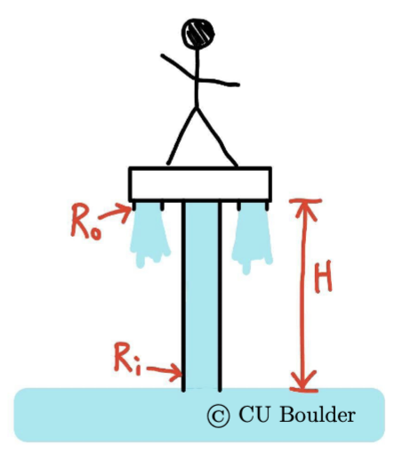
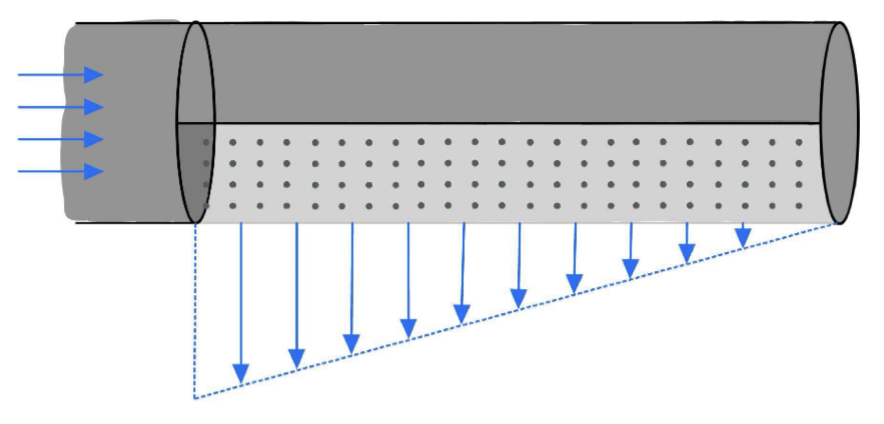

# Homework 5

Due: Friday 30 October, 2026 11:59PM. Submitted to GradeScope.

## 1. You have purchased a water hoverboard...

... and your awesomeness is depicted below. The board has a pump built into it, drawing water vertically up from just beneath the surface of the lake below through a tube with radius $R_i$. The water sprays out from two jets vertically downward, coming from outlets with radii $R_o$. You+the board have a weight $mg$. For your first ride, you would just like to hover in place a height $H$ above the lake.

{width=40%}

(a) Sketch the situation, including a control volume that goes from the bottom of the tube at the same elevation as the lake's surface up through the tube to the jet outlet.

(b) Assume uniform inlet and outlet velocity profiles. Use the integral form of conservation of mass to relate the inlet velocity to the outlet velocity. (And relate both to $Q$, the volumetric flow rate.)

(c) Use the integral form of conservation of momentum to determine the necessary $Q$ to support weight $mg$ at height $H$. Hint: draw a streamline from somewhere on the lake's surface where we might assume the velocity is zero to the tube inlet... this will get you the pressure at the inlet.

(d) Use the integral form of conservation of energy to determine the pump work rate $\dot{W}$ necessary to achieve this circumstance.

(e) Now suppose you lean forward with an angle $\beta$, with the water still drawn in vertically but now jetted out at the angle. The hoverboard is sophisticated and automatically adjusts its flow to keep you at the same altitude. What is the new necessary volumetric flow rate, work rate, and what is your forward acceleration in the first moment (i.e., don't worry about drag)?

## 2. The Teenage Mutant Ninja Turtles are enjoying some pizza in the sewer...

... and playing with Donatello's new invention: a water cannon. The turtles are taking turns shooting the cannon vertically to hit a circular sewer cover, lifting it up and trying to balance it at the top of the water stream.

(a) The water stream, density $\rho$, emerges from the cannon with area $A_0$ and speed $U_0$. As the water stream rises in elevation, it will slow down. Assuming it always maintains a uniform speed across its cross-section, determine the speed of the flow at a given elevation $H$ above the water source, and also determine the corresponding cross-sectional area at that elevation. (Just before impact... the velocity is still entirely vertical.)

(b) One of the turtles succeeds at balancing the sewer cover at a height $H$ above the cannon. The stream is diverted into a uniform radial flow at the cover. At the edge of the cover, at radius $R$, the flow is uniform in the radial direction, with the fluid layer being of thickness $w$. Draw a control volume in contact with the plate, a little bit thicker than $w$, and including the flow in. Use your answer from (a) to determine the uniform velocity of the radial flow near the outside edge of the cover. You may assume $H \gg w$.

(c) Use conservation of momentum to write a relationship between the weight of the sewer cover, $mg$, and the other parameters in the problem.

(d) Sewer covers can weigh 50 kg. Assuming water has a density of 1000 kg/m$^3$ (always a good number in 3021), the water cannon has area 300 cm$^2$, and the plate hovers 6 m above the cannon, what is the necessary speed of the cannon $U_0$? *(Hint: we could solve for $U_0$ in the equation from part (c) using the quadratic equation, but you may instead answer by having your equation numerically solved using Wolfram Alpha.)*

## 3. At the end of a cylindrical pipe...

... half of the pipe is porous (assume the pores are infinitely small and close together), with a steady outflow described by
$$
u_r(z) = U_0\left(1 - \frac{z}{L}\right).
$$
That is, the flow "out" is **radial** with dependence on the **axial** location, $z$. $U_0$ and $L$ are two known constants, the pipe radius $R$ is known, and the tube ends after the porous section. The flow "in" to this section of pipe is uniform in the axial direction and flow "out" occurs over the bottom half of the cylinder (e.g. over angles $0\rightarrow\pi$).

{width=60%}

Assume that the region just before the porous section has a known gauge pressure $p_0$. Determine the force (magnitude and direction) required to hold the porous section of the pipe in place. Comment on the direction — does it make sense physically?
