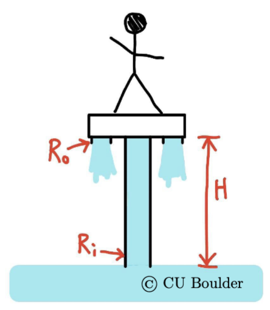
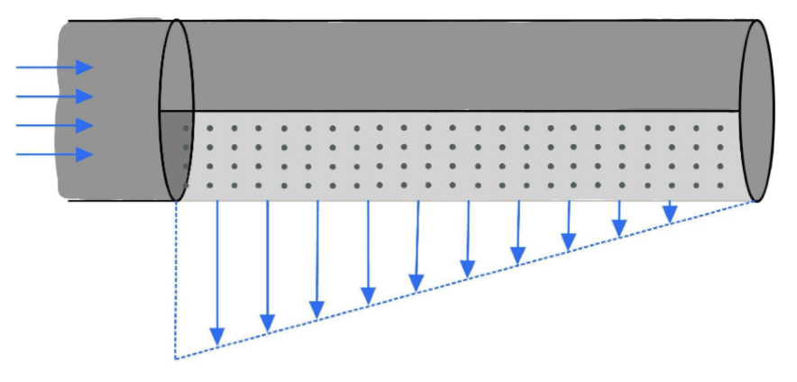

# Homework 5 Solutions

## 1. You have purchased a water hoverboard...

... and your awesomeness is depicted below. The board has a pump built into it, drawing water vertically up from just beneath the surface of the lake below through a tube with radius $R_i$. The water sprays out from two jets vertically downward, coming from outlets with radii $R_o$. You+the board have a weight $mg$. For your first ride, you would just like to hover in place a height $H$ above the lake.

{width=40%}

(a) Sketch the situation, including a control volume that goes from the bottom of the tube at the same elevation as the lake's surface up through the tube to the jet outlet.

...

(b) Assume uniform inlet and outlet velocity profiles. Use the integral form of conservation of mass to relate the inlet velocity to the outlet velocity. (And relate both to $Q$, the volumetric flow rate.)

::: {.callout-tip title="Solution" collapse="true"}
Writing out conservation of mass

$$
0 = \int \frac{\partial \rho}{\partial t} dV + \int \rho \mathbf{u}\cdot \mathbf{\hat{n}} dS
$$

We assume steady flow such that the first integral is zero. We can break down the second integral into an "in" and two "outs"

$$
0 = \int \rho \mathbf{u}\cdot \mathbf{\hat{n}} dS_\text{in} + \int \rho \mathbf{u}\cdot \mathbf{\hat{n}} dS_\text{out1} + \int \rho \mathbf{u}\cdot \mathbf{\hat{n}} dS_\text{out2}
$$

and, since we assume the flow is uniform, the integrals are easy:

$$
0 = -\rho U_\text{in} A_\text{in}+\rho U_\text{out1} A_\text{out1}+\rho U_\text{out2} A_\text{out2}.
$$

The two "outs" are the same, and we know the radius of all. So we can write it as

$$
0 = - U_\text{in} \pi R_\text{in}^2 + 2U_\text{out} \pi R_\text{out}^2
$$

and we recognize $Q= U_\text{in} \pi R_\text{in}^2$ and $Q= 2U_\text{out} \pi R_\text{out}^2$.

:::

(c) Use the integral form of conservation of momentum to determine the necessary $Q$ to support weight $mg$ at height $H$. Hint: draw a streamline from somewhere on the lake's surface where we might assume the velocity is zero to the tube inlet... this will get you the pressure at the inlet.

::: {.callout-tip title="Solution" collapse="true"}
Let's start with the hint: we start the streamline somewhere quiescent on the surface and connect it to the tube inlet at the same elevation. Bernoulli's Equation:

$$
\begin{align*}
p_0 + \frac12\rho U_0^2 + \rho g z_0 &= p_\text{in} + \frac12\rho U_\text{in}^2 + \rho g z_0\\ 
0 + 0 + 0 &= p_\text{in}+ \frac12\rho U_\text{in}^2\\
&\implies p_\text{in} = -\frac12\rho U_\text{in}^2.
\end{align*}
$$

As we'd expect: the pressure should be negative because the flow is faster here. Now, consider the forces applied to the surface.

1. We have a pressure acting over an area at the inlet $p_\text{in} A_\text{in}\mathbf{\hat{z}}$. Note that this will actually be a force in the $-\mathbf{\hat{z}}$-direction because the pressure is negative!
2. The pressure at the outlet is zero, and so we can say the pressure force on the outlets is zero.
3. We should consider the weight of the fluid column. We'll assume the amount of water in the board itself is negligible, and so the weight will be $-\rho g \pi R_\text{in}^2 H \mathbf{\hat{z}}$.
4. The weight of the rider and board is $-mg\mathbf{\hat{z}}$.

The integral form of conservation of momentum is

$$
\sum\mathbf{F}_\text{ext} = \int\frac{\partial}{\partial t}(\rho \mathbf{u}) dV + \int \rho\mathbf{u}(\mathbf{u}\cdot\mathbf{\hat{n}})dS.
$$

The first integral is again zero. The second can again be broken up into an "in" and two "outs". The evaluation is pretty easy because the integrands are constant. For the "in" integral

$$
\int \rho\mathbf{u}(\mathbf{u}\cdot\mathbf{\hat{n}})dS_\text{in} = \int \rho (U_\text{in} \mathbf{\hat{z}})(-U_\text{in})dS_\text{in} = -\rho U_\text{in}^2 \pi R_\text{in}^2\mathbf{\hat{z}}.
$$

For ONE "out" integral

$$
\int \rho\mathbf{u}(\mathbf{u}\cdot\mathbf{\hat{n}})dS_\text{out} = \int \rho (-U_\text{out} \mathbf{\hat{z}})(U_\text{out})dS_\text{out} = -\rho U_\text{out}^2 \pi R_\text{out}^2\mathbf{\hat{z}}.
$$

And so our momentum statement turns into, with the forces described above

$$
(-\frac12\rho U_\text{in}^2) A_\text{in}\mathbf{\hat{z}} -\rho g \pi R_\text{in}^2 H \mathbf{\hat{z}}-mg\mathbf{\hat{z}} = -\rho U_\text{in}^2 \pi R_\text{in}^2\mathbf{\hat{z}}-2\rho U_\text{out}^2 \pi R_\text{out}^2\mathbf{\hat{z}}.
$$

Rewriting to be in terms of $Q$, and then rearranging to solve for $Q$, we get

$$
\begin{align*}
\frac12\rho Q^2\left(\frac{1}{\pi R_\text{in}^2}+\frac{1}{\pi R_\text{out}^2}\right) &= mg + \rho g \pi R_\text{in}^2 H\\
&\implies Q = R_\text{in} R_\text{out}\sqrt{\frac{2\pi g\left(m+\rho\pi R_\text{in}^2 H\right)}{\rho\left(R_\text{in}^2+R_\text{out}^2\right)}}.
\end{align*}
$$

:::

(d) Use the integral form of conservation of energy to determine the pump work rate $\dot{W}$ necessary to achieve this circumstance.

::: {.callout-tip title="Solution" collapse="true"}
Conservation of energy:

$$
\dot{Q}_\text{in}-\dot{Q}_\text{out} + \dot{W}_\text{in}-\dot{W}_\text{out} = \int_{CV} \frac{\partial}{\partial t}(\rho e)\, dV + \int_{CS} \rho\left(e + \frac{p}{\rho}\right)(\mathbf{u}\cdot\hat{\mathbf{n}})\, dS.
$$

Assume no heat exchange and no work out. We'll also assume there is no temperature change, and of course it is steady. This equation then reduces to

$$
\dot{W}_\text{in}= \int \rho\left(\frac12 |\mathbf{u}|^2+gz + \frac{p}{\rho}\right)(\mathbf{u}\cdot\hat{\mathbf{n}})\, dS.
$$

Again, breaking it up into an "in" and "out", and assuming uniform properties across the inlet and outlet faces (this is the pipe flow simplification):

$$
\dot{W}_\text{in}= \dot{m} \left(\frac12 U_\text{out}^2 + gH + p_\text{out}/\rho\right)-\dot{m}\left(\frac12 U_\text{in}^2 + 0 + p_\text{in}/\rho\right).
$$

Plugging in for $p_\text{in}$ and $Q$, and using $p_\text{out}=0$, we can arrive at

$$
\dot{W} = \rho Q\left(\frac12 U_\text{out}^2 + gH\right) = \rho Q\left(\frac{Q^2}{8\pi^2 R_\text{out}^4} + gH\right),
$$

with $Q$ from part (c). Notice the inlet term vanished entirely: the $\frac12 U_\text{in}^2$ and the $p_\text{in}/\rho$ cancel... this is Bernoulli's Equation telling us the water arrives at the inlet with the same total energy it had sitting in the lake.

:::

(e) Now suppose you lean forward with an angle $\beta$, with the water still drawn in vertically but now jetted out at the angle. The hoverboard is sophisticated and automatically adjusts its flow to keep you at the same altitude. What is the new necessary volumetric flow rate, work rate, and what is your forward acceleration in the first moment (i.e., don't worry about drag)?

::: {.callout-tip title="Solution" collapse="true"}
Let's call $\mathbf{\hat{x}}$ the direction we're leaning, so that each jet leaves with velocity

$$
\mathbf{u}_\text{out} = U_\text{out}\left(-\sin\beta\,\mathbf{\hat{x}} - \cos\beta\,\mathbf{\hat{z}}\right).
$$

Conservation of mass only cares about how much water leaves, so part (b) is the same. The calculation of $p_\text{in}$ has nothing to do with the board angle. The only thing that changes in the $z$-momentum equation is the outlet flux, which now includes a $\cos\beta$ (only the vertical part of the jet is helping us stay up). If we assume there is no vertical acceleration, the $\mathbf{\hat{z}}$-direction is still a balance:

$$
\left(-\frac12\rho U_\text{in}^2\right) \pi R_\text{in}^2 -\rho g \pi R_\text{in}^2 H-mg = -\rho U_\text{in}^2 \pi R_\text{in}^2-2\rho U_\text{out}^2 \pi R_\text{out}^2\cos\beta.
$$

::: {.column-margin}
There is only one factor of $\cos\beta$ — the outward-facing normal is still aligned with the flow.
:::

Algebra (similar to (c)):

$$
\begin{align*}
\frac12\rho Q_\beta^2\left(\frac{1}{\pi R_\text{in}^2}+\frac{\cos\beta}{\pi R_\text{out}^2}\right) &= mg + \rho g \pi R_\text{in}^2 H\\
&\implies Q_\beta = R_\text{in} R_\text{out}\sqrt{\frac{2\pi g\left(m+\rho\pi R_\text{in}^2 H\right)}{\rho\left(R_\text{out}^2+R_\text{in}^2\cos\beta\right)}}.
\end{align*}
$$

A quick check: $\beta=0$ gets us back to part (c), and since $\cos\beta<1$ the flow rate has to go up when we lean, which is what the "sophisticated" board is doing for us. 

An interesting note: At $\beta=90^\circ$ the answer is still finite... the jets are doing nothing vertical and so the hover is supported just by the flow "in".

For the work rate, energy is a scalar, so the jet's direction never enters. Everything in part (d) carries over, just with the new flow rate:

$$
\dot{W}_\beta = \rho Q_\beta\left(\frac{Q_\beta^2}{8\pi^2 R_\text{out}^4} + gH\right).
$$

Regarding the acceleration: the $\mathbf{\hat{x}}$-momentum comes from the flow "out". You hopefully are starting to see the pattern:

$$
F_x = -2\rho U_\text{out}^2 \pi R_\text{out}^2\sin\beta .
$$

Then $F=ma$...
$$
a = \frac{2\rho U_\text{out}^2 \pi R_\text{out}^2\sin\beta}{m_\text{tot}} = \frac{\rho Q_\beta^2\sin\beta}{2\pi R_\text{out}^2\, m_\text{tot}}
$$

where $m_\text{tot}=m + \rho \pi R_\text{in}^2 H$, the total mass of the board+rider+water in the tube.

:::

## 2. The Teenage Mutant Ninja Turtles are enjoying some pizza in the sewer...

... and playing with Donatello's new invention: a water cannon. The turtles are taking turns shooting the cannon vertically to hit a circular sewer cover, lifting it up and trying to balance it at the top of the water stream.

(a) The water stream, density $\rho$, emerges from the cannon with area $A_0$ and speed $U_0$. As the water stream rises in elevation, it will slow down. Assuming it always maintains a uniform speed across its cross-section, determine the speed of the flow at a given elevation $H$ above the water source, and also determine the corresponding cross-sectional area at that elevation. (Just before impact... the velocity is still entirely vertical.)

::: {.callout-tip title="Solution" collapse="true"}
This problem can be solved with Bernoulli's Equation. Writing along a streamline from state "0" to state "H"

$$
p_0+\frac{1}{2}\rho U^2_0+\rho g z_0 = p_H+\frac{1}{2}\rho U^2_H + \rho g z_H
$$

we make the following assumptions: that both positions are exposed to ambient air, $p_0=p_H=0$; and that $z_0=0$, thus $z_H=H$. Rewriting for $U_H$

$$
U_H= \sqrt{U^2_0-2gH}.
$$

Now we do a quick conservation of mass, since we are at uniform speed: $U_0 A_0 = U_H A_H$. We therefore find

$$
A_H = \frac{U_0 A_0}{U_H} = \frac{U_0 A_0}{\sqrt{U^2_0-2gH}}.
$$
:::

(b) One of the turtles succeeds at balancing the sewer cover at a height $H$ above the cannon. The stream is diverted into a uniform radial flow at the cover. At the edge of the cover, at radius $R$, the flow is uniform in the radial direction, with the fluid layer being of thickness $w$. Draw a control volume in contact with the plate, a little bit thicker than $w$, and including the flow in. Use your answer from (a) to determine the uniform velocity of the radial flow near the outside edge of the cover. You may assume $H \gg w$.

::: {.callout-tip title="Solution" collapse="true"}
In the later parts of this problem we will use a control volume that is thin and near the cover. The benefit of this choice is that we can neglect the gravitational force acting on the control volume. Let's go ahead and use that control volume here as well — it coincides with the plate and extends a distance $w$ below the plate, forming a cylinder.

Again with a quick application of conservation of mass, we can say that the flow into this control volume matches the flow out: $U_H A_H = U_R A_R$ (a reasonable shortcut since we are assuming uniform flow at the inlet/outlet). But what is $A_R$? It is the area of the curved part of a cylinder: $A_R=2\pi R w$. Thus

$$
U_R = \frac{U_0 A_0}{2\pi R w}
$$

where we used $U_H A_H = U_0 A_0$.
:::

(c) Use conservation of momentum to write a relationship between the weight of the sewer cover, $mg$, and the other parameters in the problem.

::: {.callout-tip title="Solution" collapse="true"}
The general statement of conservation of momentum is

$$
\sum\mathbf{F}_\text{ext} = \int\limits_{cv}\frac{\partial}{\partial t}\left(\rho\mathbf{u}\right)dV +\int\limits_{cs}\rho\mathbf{u}\left(\mathbf{u}\cdot\mathbf{\hat{n}}\right)dS
$$

where we are using the control volume described above, taking the form of a cylinder with radius $R$ and height $w$.

We assume steady flow, uniform flow at the inlets and outlets, and that the only force acting on the control volume is from the weight of the plate $-mg\mathbf{\hat{z}}$. The problem is dramatically simplified if we recognize that the "out" flow in the radial direction will have velocity in the $\mathbf{\hat{r}}$-direction. Properly handling this mathematically in our LINEAR momentum equation is actually pretty tough, but we can notice either or both of: (1) the symmetry of the situation means that, when integrating around the circle, the contributions all cancel out; (2) the external force is only acting in $-\mathbf{\hat{z}}$, and so this direction is where our attention should be focused. Thus

$$
-mg\mathbf{\hat{z}} =\int\limits_\text{in}\rho\mathbf{u}\left(\mathbf{u}\cdot\mathbf{\hat{n}}\right)dS_\text{in}=\int\limits_\text{in}\left(\rho U_H \mathbf{\hat{z}}\right)\left(U_H \mathbf{\hat{z}}\cdot(-\mathbf{\hat{z}})\right)dS_\text{in}=-\rho U^2_H A_H\mathbf{\hat{z}}.
$$

That is

$$
mg= \rho U^2_H A_H = \rho U_H U_0 A_0 = \rho U_0 A_0\sqrt{U^2_0-2gH}.
$$

Leaving it in this form is fine — this can be solved explicitly for $U_0$ using the quadratic equation, but I am just going to solve it numerically in the next step.
:::

(d) Sewer covers can weigh 50 kg. Assuming water has a density of 1000 kg/m$^3$ (always a good number in 3021), the water cannon has area 300 cm$^2$, and the plate hovers 6 m above the cannon, what is the necessary speed of the cannon $U_0$? *(Hint: we could solve for $U_0$ in the equation from part (c) using the quadratic equation, but you may instead answer by having your equation numerically solved using Wolfram Alpha.)*

::: {.callout-tip title="Solution" collapse="true"}
Plugging in these numbers, we have

$$
(50~\text{kg})(9.81~\text{N/kg}) = (1000~\text{kg/m}^3)(U_0)(0.0300~\text{m}^2)\sqrt{U^2_0-2(9.81~\text{m/s}^2)(6~\text{m})}
$$

::: {.column-margin}
I use the natural language input and type `solve 50*9.81 = 1000*x*0.0300*sqrt(x^2-2*9.81*6)`, then choose "Approximate forms".
:::

and solving numerically using Wolfram Alpha, I find $U_0=11.0$ m/s.
:::

## 3. At the end of a cylindrical pipe...

... half of the pipe is porous (assume the pores are infinitely small and close together), with a steady outflow described by
$$
u_r(z) = U_0\left(1 - \frac{z}{L}\right).
$$
That is, the flow "out" is **radial** with dependence on the **axial** location, $z$. $U_0$ and $L$ are two known constants, the pipe radius $R$ is known, and the tube ends after the porous section. The flow "in" to this section of pipe is uniform in the axial direction and flow "out" occurs over the bottom half of the cylinder (e.g. over angles $0\rightarrow\pi$).

{width=60%}

Assume that the region just before the porous section has a known gauge pressure $p_0$. Determine the force (magnitude and direction) required to hold the porous section of the pipe in place. Comment on the direction — does it make sense physically?

::: {.callout-tip title="Solution" collapse="true"}
The control volume will cover the full porous section cylinder: it cuts across the pipe just upstream (where we know $p_0$), and everywhere else it sits just outside the pipe wall and the pores. The pressure distribution inside the pipe, and whatever the water is doing to the end of the tube, are then all internal to the control volume and so we don't need to calculate them. The only external forces left are the pressure at the inlet, the weight of the water (assuming it fills up the whole cylinder), and the holding force $\mathbf{F}$.

We'll take $\mathbf{\hat{z}}$ pointing downstream along the axis, $\mathbf{\hat{y}}$ pointing up, and measure $\theta$ from a horizontal $\mathbf{\hat{x}}$ around through the bottom of the pipe, so that

$$
\mathbf{\hat{r}} = \cos\theta\,\mathbf{\hat{x}} - \sin\theta\,\mathbf{\hat{y}}
$$

and $\theta$ from $0$ to $\pi$ covers the bottom half.

We need the inlet speed first, so conservation of mass. It's steady, the inflow is uniform, and an element of the porous surface has area $dS = R\,d\theta\,dz$:

$$
0 = -\rho U_\text{in}\pi R^2 + \int_0^L\int_0^\pi \rho U_0\left(1-\frac{z}{L}\right) R\,d\theta\,dz = -\rho U_\text{in}\pi R^2 + \rho U_0 \pi R\frac{L}{2}.
$$

That is

$$
U_\text{in} = \frac{U_0 L}{2R}.
$$

Now conservation of momentum, again steady:

$$
\mathbf{F} + p_0\pi R^2\,\mathbf{\hat{z}} - \rho g \pi R^2 L\,\mathbf{\hat{y}} = \int \rho\mathbf{u}(\mathbf{u}\cdot\mathbf{\hat{n}})dS_\text{in} + \int \rho\mathbf{u}(\mathbf{u}\cdot\mathbf{\hat{n}})dS_\text{out}.
$$

The pressure force at the inlet pushes into the control volume, so it points in $+\mathbf{\hat{z}}$. Everywhere else the pressure is zero (gauge), including at the pores, which discharge to the atmosphere. The weight of the water in the section acts in $-\mathbf{\hat{y}}$. (We aren't given the mass of the pipe itself, so we'll leave it out... it would just tack on one more vertical force.)

The "in" integral is easy, because the integrand is constant:

$$
\int \rho\left(U_\text{in}\mathbf{\hat{z}}\right)\left(-U_\text{in}\right)dS_\text{in} = -\rho U_\text{in}^2\pi R^2\,\mathbf{\hat{z}}.
$$

The "out" integral is more complicated... we actually have to use calculus. The velocity is $u_r\mathbf{\hat{r}}$, and $\mathbf{u}\cdot\mathbf{\hat{n}}=u_r$ because the outward normal is $\mathbf{\hat{r}}$ on this surface. The direction $\mathbf{\hat{r}}$ changes as we go around the pipe, so it has to stay inside the integral:

$$
\begin{align*}
\int \rho\mathbf{u}(\mathbf{u}\cdot\mathbf{\hat{n}})dS_\text{out} &= \int_0^L\int_0^\pi \rho U_0^2\left(1-\frac{z}{L}\right)^2\left(\cos\theta\,\mathbf{\hat{x}} - \sin\theta\,\mathbf{\hat{y}}\right) R\,d\theta\,dz\\
&= \rho U_0^2 R\left(\frac{L}{3}\right)\left(0\,\mathbf{\hat{x}} - 2\,\mathbf{\hat{y}}\right)\\
&= -\frac23\rho U_0^2 R L\,\mathbf{\hat{y}}.
\end{align*}
$$

Note that the outflow is purely radial, so it carries no $z$-momentum at all. Then

$$
\mathbf{F} = -\left(p_0\pi R^2 + \rho U_\text{in}^2\pi R^2\right)\mathbf{\hat{z}} + \left(\rho g\pi R^2 L - \frac23\rho U_0^2 R L\right)\mathbf{\hat{y}},
$$

and with $U_\text{in}=U_0L/(2R)$,

$$
\mathbf{F} = -\left(p_0\pi R^2 + \frac{\pi}{4}\rho U_0^2 L^2\right)\mathbf{\hat{z}} + \left(\rho g\pi R^2 L - \frac23\rho U_0^2 R L\right)\mathbf{\hat{y}}.
$$

:::

