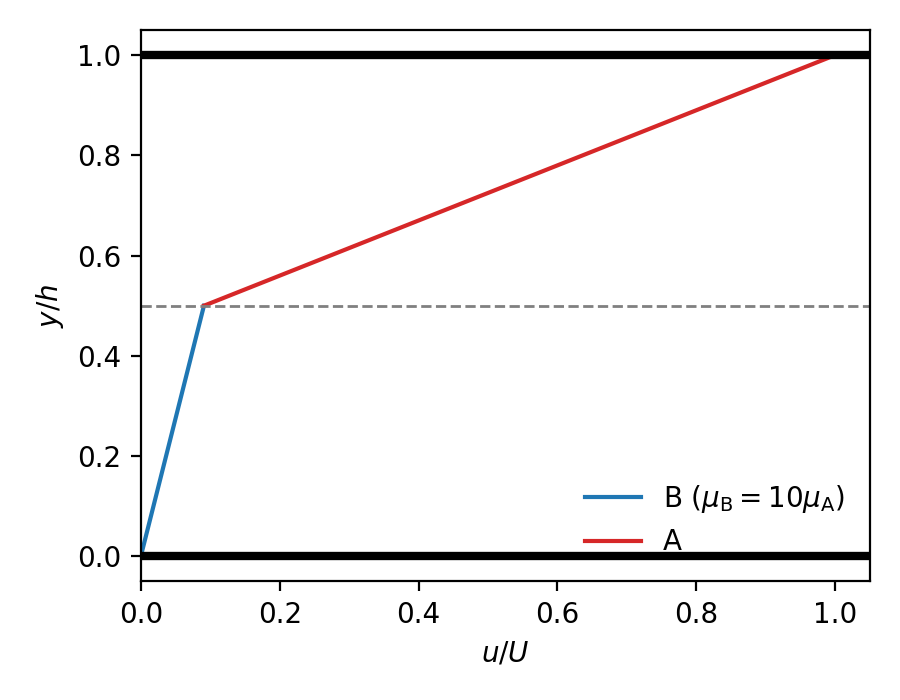
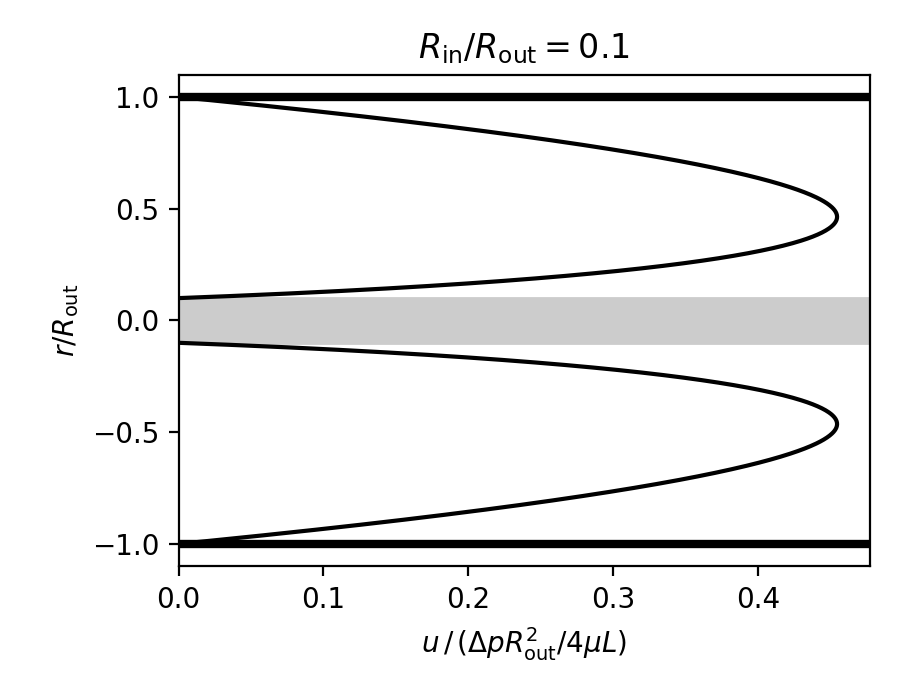

# Homework 6 Solutions

$$
\newcommand{\pd}[2]{\dfrac{\partial #1}{\partial #2}}
\newcommand{\pdd}[2]{\dfrac{\partial^2 #1}{\partial #2^2}}
\newcommand{\bnabla}{\boldsymbol{\nabla}}
\newcommand{\unit}[1]{\mathbf{\hat{#1}}}
$$

## 1. Two fluids are stacked between two plates...

... in the boundary-driven Cartesian geometry from the reading. The plates are separated by a distance $h$. Fluid "A" (with known $\rho_\text{A}$, $\mu_\text{A}$) sits on top of fluid "B" ($\rho_\text{B}$, $\mu_\text{B}$), and their interface is a distance $h_\text{AB}$ above the bottom plate. The bottom plate is stationary, the top plate moves with speed $U$, and the system has reached steady state.

Assume that both fluids move horizontally and that their interface remains at a constant height above the bottom plate.

(a) For fluid "A", write out the full conservation of mass and $\unit{x}$-momentum equations and then simplify them, stating the assumption/reason you eliminate each term. (The simplification for "B" is exactly the same, so you don't need to repeat it.)

::: {.callout-tip title="Solution" collapse="true"}
We'll set things up just like the reading: $x$ in the flow direction, $y$ measured up from the bottom plate (so fluid B lives in $0\le y\le h_\text{AB}$ and fluid A in $h_\text{AB}\le y\le h$), and gravity $\mathbf{g}=-g\unit{y}$. Conservation of mass for fluid A is

$$
\pd{u_\text{A}}{x}+\pd{v_\text{A}}{y}+\pd{w_\text{A}}{z}=0.
$$

The fluids move horizontally, so $v_\text{A}=0$, and we assume nothing happens in $z$, so $w_\text{A}=0$. That leaves

$$
\pd{u_\text{A}}{x}=0
$$

and so the velocity profile doesn't change as we move along the plates. The $\unit{x}$-momentum equation is

$$
\rho_\text{A}\left(\pd{u_\text{A}}{t}+u_\text{A}\pd{u_\text{A}}{x}+v_\text{A}\pd{u_\text{A}}{y}+w_\text{A}\pd{u_\text{A}}{z}\right)=
-\pd{p}{x}+\mu_\text{A}\left(\pdd{u_\text{A}}{x}+\pdd{u_\text{A}}{y}+\pdd{u_\text{A}}{z}\right).
$$

Going term by term:

- $\partial u_\text{A}/\partial t$: steady state.
- $u_\text{A}\,\partial u_\text{A}/\partial x$ and $\partial^2 u_\text{A}/\partial x^2$: conservation of mass told us $\partial u_\text{A}/\partial x=0$ everywhere.
- $v_\text{A}\,\partial u_\text{A}/\partial y$ and $w_\text{A}\,\partial u_\text{A}/\partial z$: $v_\text{A}=w_\text{A}=0$.
- $\partial^2 u_\text{A}/\partial z^2$: nothing depends on $z$.
- $\partial p/\partial x$: this is boundary-driven flow, so there's no applied pressure gradient. (The only pressure variation is hydrostatic, in $y$, and it doesn't care what the plates are doing.)

Gravity points in $-\unit{y}$, so it never shows up in the $\unit{x}$-equation. What survives is

$$
0=\mu_\text{A}\frac{d^2 u_\text{A}}{dy^2}.
$$

Notice that $\rho_\text{A}$ dropped out completely... the densities only matter for keeping A on top of B (which we're told is happening).
:::

(b) Clearly state the ordinary differential equation you will solve for both "A" and "B", and the boundary conditions (expressed mathematically). *(Hint: there is no slip at the interface, and at steady state the shear stress must match across the interface.)*

::: {.callout-tip title="Solution" collapse="true"}
The same steps apply to fluid B, so we have one ODE for each fluid:

$$
\frac{d^2 u_\text{A}}{dy^2}=0\quad\left(h_\text{AB}\le y\le h\right),\qquad
\frac{d^2 u_\text{B}}{dy^2}=0\quad\left(0\le y\le h_\text{AB}\right).
$$

Two second-order ODEs means we need four boundary conditions. Two come from the plates and two from the interface:

$$
\begin{align*}
&u_\text{B}(0)=0\quad\text{(no slip at the bottom plate)}\\
&u_\text{A}(h)=U\quad\text{(no slip at the top plate)}\\
&u_\text{A}(h_\text{AB})=u_\text{B}(h_\text{AB})\quad\text{(no slip at the interface)}\\
&\mu_\text{A}\left.\frac{du_\text{A}}{dy}\right|_{h_\text{AB}}=\mu_\text{B}\left.\frac{du_\text{B}}{dy}\right|_{h_\text{AB}}\quad\text{(shear stress matches at the interface)}.
\end{align*}
$$

The last one is Newton's third law in disguise: A drags B forward exactly as hard as B drags A backward. If the stresses didn't match, a massless sliver of fluid at the interface would have a net force on it and infinite acceleration. Not great.

Note that the stress condition is *not* "the slopes match." The viscosities are different, so the slopes will be too.
:::

(c) Solve for the velocity distributions.

::: {.callout-tip title="Solution" collapse="true"}
Integrating twice (exactly as in the reading), both profiles are straight lines:

$$
u_\text{A}(y)=a_\text{A}y+b_\text{A},\qquad u_\text{B}(y)=a_\text{B}y+b_\text{B}.
$$

Now we march through the four boundary conditions. No slip at the bottom gives $b_\text{B}=0$ right away. The stress condition gives

$$
\mu_\text{A}a_\text{A}=\mu_\text{B}a_\text{B}\implies a_\text{B}=\frac{\mu_\text{A}}{\mu_\text{B}}a_\text{A}.
$$

The top plate gives $a_\text{A}h+b_\text{A}=U$, and interface no-slip gives $a_\text{A}h_\text{AB}+b_\text{A}=a_\text{B}h_\text{AB}$. Subtracting the second of these from the first gets rid of $b_\text{A}$:

$$
a_\text{A}\left(h-h_\text{AB}\right)+\frac{\mu_\text{A}}{\mu_\text{B}}a_\text{A}h_\text{AB}=U
\implies a_\text{A}=\frac{\mu_\text{B}U}{\mu_\text{B}\left(h-h_\text{AB}\right)+\mu_\text{A}h_\text{AB}}.
$$

The denominator is going to show up everywhere, so let's give it a name: $D\equiv\mu_\text{B}\left(h-h_\text{AB}\right)+\mu_\text{A}h_\text{AB}$. Then $a_\text{B}=\mu_\text{A}U/D$ and $b_\text{A}=U-a_\text{A}h=U\left(\mu_\text{A}-\mu_\text{B}\right)h_\text{AB}/D$. Putting it all together:

$$
\boxed{
u_\text{B}(y)=\frac{\mu_\text{A}U}{\mu_\text{B}\left(h-h_\text{AB}\right)+\mu_\text{A}h_\text{AB}}\,y,\qquad
u_\text{A}(y)=U\,\frac{\mu_\text{B}\left(y-h_\text{AB}\right)+\mu_\text{A}h_\text{AB}}{\mu_\text{B}\left(h-h_\text{AB}\right)+\mu_\text{A}h_\text{AB}}.
}
$$

A few sanity checks before we trust this. At $y=h$, the top of $u_\text{A}$ becomes $\mu_\text{B}(h-h_\text{AB})+\mu_\text{A}h_\text{AB}=D$, so $u_\text{A}=U$. Good. If the two fluids are the same ($\mu_\text{A}=\mu_\text{B}$), both expressions collapse to $u=Uy/h$, the single-fluid answer from the reading. Good. And if B gets *really* viscous ($\mu_\text{B}\to\infty$), then $u_\text{B}\to0$ and $u_\text{A}\to U(y-h_\text{AB})/(h-h_\text{AB})$: fluid B acts like a solid floor and A does ordinary Couette flow on top of it. Also good.

One more way to look at it, if you like circuits. The shear stress is the same everywhere in the gap, and it works out to

$$
\tau=\mu_\text{A}a_\text{A}=\frac{U}{\dfrac{h-h_\text{AB}}{\mu_\text{A}}+\dfrac{h_\text{AB}}{\mu_\text{B}}}.
$$

That's Ohm's law for two resistors in series: $U$ is the "voltage," $\tau$ is the "current," and each layer has a "resistance" of thickness/viscosity. The layer with the bigger resistance takes the bigger share of the velocity "drop." (The analogy is exact here because everything is linear. Don't push it much further than that.)
:::

(d) Sketch the profiles when $\mu_\text{B}=10\mu_\text{A}$.

::: {.callout-tip title="Solution" collapse="true"}
We need to pick an interface height, so let's take $h_\text{AB}=h/2$. Then $D=\mu_\text{A}\left(10\cdot\tfrac{h}{2}+\tfrac{h}{2}\right)=5.5\mu_\text{A}h$, and the interface moves at

$$
u(h_\text{AB})=\frac{\mu_\text{A}U}{5.5\mu_\text{A}h}\cdot\frac{h}{2}=\frac{U}{11}\approx0.09\,U.
$$

So both profiles are straight lines with a kink at the interface. The slope in A is ten times steeper (in the $u$-direction) than in B, because $\mu_\text{A}\,du_\text{A}/dy=\mu_\text{B}\,du_\text{B}/dy$:

{width=50%}

The thick, gloopy fluid B barely moves, and almost all of the velocity change happens across the thin, runny fluid A. Hopefully that matches your intuition (spread honey on a plate, put water on top, and drag a spatula across the water... the honey isn't going anywhere fast). Choosing a different $h_\text{AB}$ moves the kink, but the factor-of-ten slope ratio stays.
:::

## 2. A wall shakes back and forth...

... underneath a semi-infinite bath of fluid. The fluid fills $y>0$ and the wall is located at $y=0$. The wall oscillates left-to-right with a speed $U\cos(\omega t)$, where $U$ and $\omega$ are known constants. Far from the wall, the fluid is stationary. The flow has constant $\rho$ and $\nu\equiv \mu/\rho$ (kinematic viscosity), and gravity can be neglected.

(a) Write the simplified form of the Navier-Stokes equations that applies to this situation. You only need to consider mass and $\unit{x}$-momentum, and do NOT need to solve them — just arrive at the simplified governing equations.

::: {.callout-tip title="Solution" collapse="true"}
Conservation of mass for a constant density flow in Cartesian coordinates is

$$
\pd{u}{x}+\pd{v}{y}+\pd{w}{z}=0
$$

where we assume $v=0=w$, and so the above simplifies to

$$
\pd{u}{x}=0.
$$

The $x$-momentum equation is

$$
\rho\left(\pd{u}{t}+u\pd{u}{x}+v\pd{u}{y}+w\pd{u}{z}\right)=
-\pd{p}{x}+\mu\left(\pdd{u}{x}+\pdd{u}{y}+\pdd{u}{z}\right).
$$

We assume there is no variation in pressure in the $x$-direction (or any direction), and that the flow is uniform in the $z$-direction. Then, with all the above assumptions, the $x$-momentum reduces to

$$
\rho\pd{u}{t}=\mu\pdd{u}{y}.
$$

(Or can use $\nu\equiv\mu/\rho$.)
:::

(b) State the boundary conditions for $u$. (Don't worry about the initial condition.)

::: {.callout-tip title="Solution" collapse="true"}
The boundary conditions for this flow are

$$
\begin{align*}
&u(y=0,t)=U\cos{(\omega t)}\\
&u(y=\infty,t)=0.
\end{align*}
$$
:::

(c) There is an exact solution to this situation, a little tricky to get to, given by:
$$
u(y,t)=U\exp\left[-y\sqrt{\frac{\omega}{2\nu}}\right]\cos\left[\omega t-y\sqrt{\frac{\omega}{2\nu}}\right].
$$
Don't worry about where it comes from (PDE witchcraft), but do verify that it satisfies

  i. conservation of mass,
  ii. the simplified governing equation you found in (a), and
  iii. the boundary conditions you found in (b).

::: {.callout-tip title="Solution" collapse="true"}
Conservation of mass is quick: the given $u$ depends only on $y$ and $t$, so $\partial u/\partial x=0$.

Evaluating the given function at $y=0$:

$$
u(0,t)=U\exp{\left[0\right]}\cos{\left[\omega t-0\right]}=U\cos{\omega t}
$$

and evaluating the function at $y=\infty$

$$
u(\infty,t)=U\exp{\left[-\infty\right]}\cos{\left[\omega t-\infty\right]}=0
$$

and so the boundary conditions are satisfied.

Taking the time derivative of the given function, we get

$$
\pd{u}{t}=-\omega U\exp{\left[-y\sqrt{\frac{\omega}{2\nu}}\right]}\sin{\left[\omega t-y\sqrt{\frac{\omega}{2\nu}}\right]}.
$$

We also need to evaluate the second spatial derivative, which, if done by hand, will require the product rule (and chain rule). It isn't too tough, but I'll just use Wolfram Alpha:

$$
\pdd{u}{y}=-U\frac{\omega}{\nu}\exp{\left[-y\sqrt{\frac{\omega}{2\nu}}\right]}\sin{\left[\omega t-y\sqrt{\frac{\omega}{2\nu}}\right]}.
$$

Multiplying the first of these results by $\rho$, and the second by $\mu$ (with $\nu\equiv\mu/\rho$), we recognize that these expressions are the same, and therefore the solution given satisfies the governing equation.
:::

(d) There is a location $y^*$ beyond which $|u|\leq 0.01 U$ for all times. Find $y^*$. *(Hint: what is the absolute biggest the cosine term could be?)*

::: {.callout-tip title="Solution" collapse="true"}
The cosine is never bigger than 1 in magnitude, so the envelope $U\exp\left[-y\sqrt{\omega/2\nu}\right]$ bounds $|u|$. Setting the envelope equal to $0.01U$:

$$
\exp\left[-y^*\sqrt{\frac{\omega}{2\nu}}\right]=0.01\implies y^*=\ln(100)\sqrt{\frac{2\nu}{\omega}}\approx4.6\sqrt{\frac{2\nu}{\omega}}.
$$
:::

## 3. A fluid flows between two concentric cylinders...

... with density $\rho$ and viscosity $\mu$. The inner cylinder has radius $R_\text{in}$, the outer cylinder has radius $R_\text{out}$, and both cylinders are stationary and infinitely long. An applied pressure gradient drives the fluid axially, such that the pressure drops by $\Delta p$ over an axial distance $L$.

Determine the velocity distribution, assuming steady flow. Make a plot of the distribution.

::: {.callout-tip title="Solution" collapse="true"}
The geometry and assumptions associated with this flow are exactly the same as for the cylindrical Poiseuille Flow, thus we arrive at the same governing equation (assuming $\partial p/\partial z = -\Delta p/L$)

$$
-\frac{\Delta p}{\mu L}=\frac{1}{r}\pd{}{r}\left(r \pd{u_z}{r}\right)
$$

leading to the same general solution

$$
u(r)=\frac{-\Delta p}{4\mu L}r^2 + c_1 \ln{r} + c_2.
$$

The thing that makes this problem different is the boundary conditions, which can be stated mathematically as

$$
\begin{align*}
&u(r=R_\text{out})=0\quad\text{(no slip at the outer wall)}\\
&u(r=R_\text{in})=0\quad\text{(no slip at the inner wall)}.
\end{align*}
$$

Applying these boundary conditions to the governing equations:

$$
\begin{align*}
u(r=R_\text{out})=0=&\frac{-\Delta p}{4\mu L}R_\text{out}^2 + c_1 \ln{R_\text{out}} + c_2\\
u(r=R_\text{in})=0=&\frac{-\Delta p}{4\mu L}R_\text{in}^2 + c_1 \ln{R_\text{in}} + c_2.
\end{align*}
$$

What is left is basically just algebra: two equations and two unknowns, $c_1$ and $c_2$. This can be done in a few ways, here is one: subtract the first equation from the second to get

$$
0=\frac{-\Delta p}{4\mu L}\left(R_\text{in}^2-R_\text{out}^2\right) + c_1\left(\ln{R_\text{in}}-\ln{R_\text{out}}\right)
$$

from which we can solve for $c_1$, noting $\ln{R_\text{in}}-\ln{R_\text{out}}=\ln{(R_\text{in}/R_\text{out})}$:

$$
c_1=\frac{\Delta p}{4\mu L}\left(\frac{R_\text{in}^2-R_\text{out}^2}{\ln{(R_\text{in}/R_\text{out})}}\right).
$$

This can be plugged into either of the above boundary conditions to obtain $c_2$, e.g.,

$$
\begin{align*}
0&=\frac{-\Delta p}{4\mu L}R_\text{out}^2 + \left[
\frac{\Delta p}{4\mu L}\left(\frac{R_\text{in}^2-R_\text{out}^2}{\ln{(R_\text{in}/R_\text{out})}}\right)
\right] \ln{R_\text{out}} + c_2\\
&\implies c_2=\frac{\Delta p}{4\mu L}\left[R_\text{out}^2-\left(R_\text{in}^2-R_\text{out}^2\right)\left(\frac{\ln{R_\text{out}}}{\ln{(R_\text{in}/R_\text{out})}}\right)
\right]
\end{align*}
$$

and so the solution is

$$
u(r)=\frac{-\Delta p}{4\mu L}r^2+
\left[\frac{\Delta p}{4\mu L}\left(\frac{R_\text{in}^2-R_\text{out}^2}{\ln{(R_\text{in}/R_\text{out})}}\right)\right]\ln{r}+
\frac{\Delta p}{4\mu L}\left[R_\text{out}^2-\left(R_\text{in}^2-R_\text{out}^2\right)\left(\frac{\ln{R_\text{out}}}{\ln{(R_\text{in}/R_\text{out})}}\right)
\right].
$$

This can be rewritten as

$$
u(r)=\frac{\Delta p}{4\mu L}\left[
\left(R_\text{out}^2-r^2\right)+
\left(R_\text{in}^2-R_\text{out}^2\right)\left(\frac{\ln{(r/R_\text{out})}}{\ln{(R_\text{in}/R_\text{out})}}\right)
\right].
$$

The plot looks like this (here for $R_\text{in}/R_\text{out}=0.1$):

{width=50%}

An equivalent solution will emerge if different algebra steps are followed. For example, if we take the $c_1$ determined above and instead plug it in to the boundary condition at $r=R_\text{in}$:

$$
\begin{align*}
0&=\frac{-\Delta p}{4\mu L}R_\text{in}^2 +
\left[
\frac{\Delta p}{4\mu L}\left(\frac{R_\text{in}^2-R_\text{out}^2}{\ln{(R_\text{in}/R_\text{out})}}\right)\right]
\ln{R_\text{in}} + c_2\\
&\implies c_2=\frac{\Delta p}{4\mu L}\left[R_\text{in}^2-\left(R_\text{in}^2-R_\text{out}^2\right)\left(\frac{\ln{R_\text{in}}}{\ln{(R_\text{in}/R_\text{out})}}\right)\right].
\end{align*}
$$

Then we note

$$
\frac{\ln{R_\text{in}}}{\ln{(R_\text{in}/R_\text{out})}}=\frac{\ln{(R_\text{in}/R_\text{out})}+\ln R_\text{out}}{\ln{(R_\text{in}/R_\text{out})}}=1+\frac{\ln R_\text{out}}{\ln{(R_\text{in}/R_\text{out})}}
$$

and so inside the square bracket above

$$
\begin{align*}
&\left[R_\text{in}^2-\left(R_\text{in}^2-R_\text{out}^2\right)\left(1+\frac{\ln{R_\text{out}}}{\ln{(R_\text{in}/R_\text{out})}}\right)\right]\\
&\qquad=\left[R_\text{in}^2-\left(R_\text{in}^2-R_\text{out}^2\right)-\left(R_\text{in}^2-R_\text{out}^2\right)\left(\frac{\ln{R_\text{out}}}{\ln{(R_\text{in}/R_\text{out})}}\right)\right]\\
&\qquad=\left[R_\text{out}^2-\left(R_\text{in}^2-R_\text{out}^2\right)\left(\frac{\ln{R_\text{out}}}{\ln{(R_\text{in}/R_\text{out})}}\right)\right]
\end{align*}
$$

which means the $c_2$ found from this path is the same as the $c_2$ from the other path.
:::
