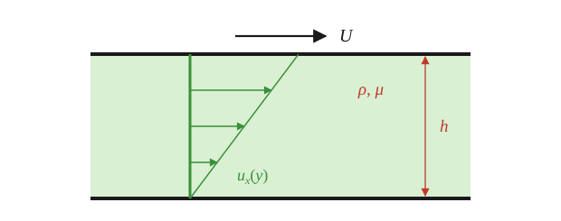
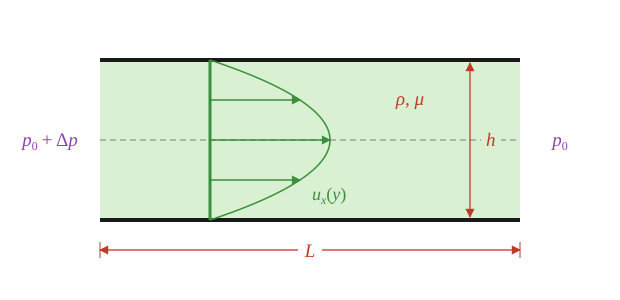

## The big idea

Recommended: take a look at [the derivation of the differential forms of our conservation laws](diff-forms.qmd). You won't need to know that derivation for an exam, but we are going to take those equations as our starting point in this lesson.

There are two basic ways to make a fluid move:

1. **Boundary-driven flow**: the flow is imposed by a known boundary condition on the velocity (a moving wall).
2. **Pressure-driven flow**: the flow is imposed by a pressure difference between two locations.

We'll use the Navier-Stokes equations to determine the resulting flow profiles in Cartesian coordinates. 

## Think first

**Recall**

1. What is the no-slip condition?
2. What are the consequences of "$u$ does not depend on $z$"? What is $\partial u/\partial z$?


**Look ahead**

1. Two parallel plates, the bottom one fixed and the top one sliding at speed $U$, with no applied pressure difference. Try to sketch $u(y)$.
2. Now both plates are fixed and a pump pushes fluid through. Where is the fluid fastest, and what is it doing at the walls?

## Setup


::: {.callout-caution}

We are going to study a special situation in this lesson: unidirectional flows. We will see that, for this class of problems, the nonlinear terms in the Navier-Stokes Equations all go to zero, and we are ultimately left with a linear differential equation. You **should not** leave this lesson with the impression that the Navier-Stokes Equations are easy to solve — in fact, unidirectional flows are one of the few cases where the equations can be solved without approximation.

I know not everyone has taken differential equations, so we are going to stick to one calculus-based solution strategy: integrate.

:::


Two infinite parallel plates are separated by a gap $h$. Between them is a fluid with density $\rho$ and viscosity $\mu$. Flow will go from left-to-right: we will take $x$ to be the coordinate in the flow direction and $y$ to be the coordinate across the fluid such that $y=0$ on the bottom plate and $y=h$ on the top plate. We assume the flow is symmetric in $z$.

We assume the flow is **unidirectional** such that 

$$
\mathbf{u}= \langle u, v, w\rangle = \langle u, 0, 0\rangle.
$$

We are going to study **boundary-driven** and **pressure-driven** flows. Both have the same initial steps. Begin by looking at **conservation of mass**:


$$
\nabla\cdot\mathbf{u} = 0 \quad\to\quad \frac{\partial u}{\partial x} + \frac{\partial v}{\partial y} + \frac{\partial w}{\partial z} = 0.
$$

We assumed the flow was unidirectional, meaning $v=0$ and $w=0$ everywhere. Derivatives of them are therefore also zero, and so our takeaway from the conservation of mass equation is $\partial u/\partial x = 0$: the velocity profile does not depend on $x$.

Then let's look at **conservation of momentum in the $\mathbf{\hat{y}}$-direction**, assuming $\mathbf{g}=-g\mathbf{\hat{y}}$. Here is the full equation (from [the differential forms lesson](diff-forms.qmd)):

$$
\rho\left(\frac{\partial v}{\partial t} + u\frac{\partial v}{\partial x} + v\frac{\partial v}{\partial y} + w\frac{\partial v}{\partial z}\right) = -\frac{\partial p}{\partial y} + \mu\left(\frac{\partial^2 v}{\partial x^2} + \frac{\partial^2 v}{\partial y^2} + \frac{\partial^2 v}{\partial z^2}\right) - \rho g.
$$

Because we assumed $v=0$, this reduces to

$$
0 = -\frac{\partial p}{\partial y} - \rho g
$$

which tells us that the only reason pressure changes in the $\mathbf{\hat{y}}$-direction is due to hydrostatics. That is: the flow in the $\mathbf{\hat{x}}$-direction does not influence the pressure distribution in the $\mathbf{\hat{y}}$-direction.

Now let's look at **conservation of momentum in the $\mathbf{\hat{x}}$-direction**. The full equation is

$$
\rho\left(\frac{\partial u}{\partial t} + u\frac{\partial u}{\partial x} + v\frac{\partial u}{\partial y} + w\frac{\partial u}{\partial z}\right) = -\frac{\partial p}{\partial x} + \mu\left(\frac{\partial^2 u}{\partial x^2} + \frac{\partial^2 u}{\partial y^2} + \frac{\partial^2 u}{\partial z^2}\right).
$$


::: {.callout-important}

All of the following are zero, make sure you understand why!

- $u\, \partial u/\partial x$: from conservation of mass we learned $\partial u/\partial x=0$.
- $v\, \partial u/\partial y$: we assumed unidirectional flow, $v=0$.
- $w\, \partial u/\partial z$: we assumed unidirectional flow, $w=0$.
- $\partial^2 u/\partial x^2$: if $\partial u/\partial x=0$ everywhere, the second derivative is zero everywhere as well.
- $\partial^2 u/\partial z^2$: we assumed symmetry in $z$ such that nothing depends on $z$.

:::

An intermediate result: 

$$
\rho\frac{\partial u}{\partial t} = -\frac{\partial p}{\partial x} + \mu\frac{\partial^2 u}{\partial y^2}.
$$ {#eq-x-reduced}

At this point we specialize.

## Boundary-driven flow

We'll start with the case where the bottom plate is stationary and the top is moving to the right with speed $U$.



In such a case, the pressure gradient term is zero and we have

$$
\rho\frac{\partial u}{\partial t} =  \mu\frac{\partial^2 u}{\partial y^2}.
$$

This is a famous partial differential equation: "the heat equation" or "the diffusion equation". There are techniques to solve it, if you ever take a PDE class! I just wanted to mention it... we are also going to assume steady-state, leaving

$$
0 =  \frac{d^2 u}{d y^2}
$$ {#eq-bd-ode}

where I have replaced the partial derivatives with upright derivatives since $u$ is a function of $y$ only. To solve this equation, we'll just integrate twice, making sure to include a constant of integration with each integral. The first integration:

$$
\begin{align*}
&0 =  \frac{d^2 u}{d y^2}\\
&\implies 0 =  \frac{d}{dy}\left(\frac{du}{d y}\right)\\
&\implies \int 0 \,dy = \int  \,d\left(\frac{du}{d y}\right)\\
&\implies c_1 = \frac{du}{dy}.
\end{align*}
$$

::: {.column-margin}
We could have constants of integration for both integrals, but then they'd combine anyway, so let's just have $c_1$.

If you are uncomfortable with

$$
\int  \,d\left(\frac{du}{d y}\right) = \frac{du}{dy}+c
$$

you can think about it as 

$$
\int  \,dt = t+c
$$

with $t=du/dy$.
::: 

And the second:

$$
\begin{align*}
&c_1 = \frac{du}{dy}\\
&\implies \int c_1 \,dy =  \int \,du\\
&\implies c_1 y + c_2 = u.
\end{align*}
$$

This is the *general solution* to the differential equation in @eq-bd-ode. In order to determine the values of $c_1$ and $c_2$ we must use **boundary conditions**.


::: {.callout-important}

Boundary conditions are imposed on the flow. In this case, we are going to assume **no slip at the walls** such that the wall (boundary) motion sets the speed of the fluid nearby. Stated mathematically:

$$
\begin{align*}
u(y=0)=&0\quad\text{(the bottom wall is stationary)}\\
u(y=h)=&U\quad\text{(the top wall is moving at a known speed)}.
\end{align*}
$$
:::

We can evaluate our general solution at $y=0$ and $y=h$ and then apply the boundary conditions:

$$
\begin{align*}
u(y=0)=&0=c_2\\
u(y=h)=&U=c_1 h+c_2.
\end{align*}
$$

With a little bit of arithmetic, we find $c_1=U/h$ and $c_2=0$. That is: the solution to our problem is

$$
u(y) = U\frac{y}{h}.
$$

We'll talk more about this result later, but let's go ahead and look at pressure-driven flow first.

## Pressure-driven flow

Returning to @eq-x-reduced: let's instead say that both walls are stationary, but there is a pump or something far upstream (on the left). We'll assume that, over a distance $L$, the pressure drops by an amount $\Delta p$. More specifically: we'll assume we have the same pressure-drop-per-distance everywhere: $\partial p/\partial x = -\Delta p/L$.



Again assuming the flow is steady, our governing equation becomes 

$$
0 = \frac{\Delta p}{L} +\mu \frac{d^2 u}{dy^2}.
$$


And again, we'll solve by integration. The solution is

$$
u(y) = c_2 + c_1y- \frac{\Delta p}{2\mu L}y^2.
$$

We'll use no-slip as our boundary conditions, though in this case $u(y=0)=0=u(y=h)$. Writing the system of equations: 

$$
\begin{align*}
u(y=0)=&0=c_2\\
u(y=h)=&0=c_2+c_1 h-\frac{\Delta p}{2\mu L}h^2
\end{align*}
$$

we find $c_2=0$ and $c_1=h\Delta p/(2\mu L)$. That is


$$
u(y) = \frac{\Delta p}{2\mu L}\,y(h-y).
$$

## Combined boundary- and pressure-driven flow

The flow can be both boundary-driven (with boundary condition $u(h)=U$) and pressure-driven ($\partial p/\partial x\neq 0$). In such a case, the solution is

$$
u(y) = \underbrace{\frac{\Delta p}{2\mu L}\,y(h-y)}_{\text{pressure-driven}} + \underbrace{U\frac{y}{h}}_{\text{boundary-driven}}
$$


Dividing $u(y)$ by $U$ and writing $\eta = y/h$ shows that the whole family of profiles depends on a single dimensionless group,

$$
\frac{u}{U} = \eta + \Lambda\,\eta(1-\eta), \qquad \Lambda = \frac{h^2\,\Delta p}{2\mu L\,U}
$$

the ratio of the pressure-driven part to the boundary-driven part. Slide $\Lambda$ from a pure boundary-driven flow ($\Lambda=0$) to a pressure-dominated flow, and then to a *negative* $\Lambda$ (pressure pushing against the moving plate).

```{ojs}
//| echo: false
viewof Lam = Inputs.range([-5, 5], {value: 2, step: 0.1, label: "Λ = h²Δp / (2μLU)"})
```

```{ojs}
//| echo: false
{
  const eta = Array.from({length: 101}, (_, i) => i / 100);
  const full = eta.map(e => ({eta: e, u: e + Lam * e * (1 - e)}));
  const boundaryDriven = eta.map(e => ({eta: e, u: e}));
  const pressureDriven = eta.map(e => ({eta: e, u: Lam * e * (1 - e)}));
  const etaStar = Lam === 0 ? NaN : 0.5 + 1 / (2 * Lam);
  const interior = etaStar > 0 && etaStar < 1;
  const uStar = etaStar + Lam * etaStar * (1 - etaStar);
  const backflow = Lam < -1;
  const note = backflow ? "backflow near the bottom plate"
    : (interior && Lam > 1) ? `max u/U = ${uStar.toFixed(2)} at y/h = ${etaStar.toFixed(2)}`
    : "max speed is at the top plate";
  return Plot.plot({
    height: 360, marginLeft: 50, grid: true,
    x: {label: "u / U", domain: [-3, 4]},
    y: {label: "y / h", domain: [0, 1]},
    marks: [
      Plot.ruleX([0]),
      Plot.line(boundaryDriven, {x: "u", y: "eta", stroke: "firebrick", strokeDasharray: "4 3"}),
      Plot.line(pressureDriven, {x: "u", y: "eta", stroke: "royalblue", strokeDasharray: "4 3"}),
      Plot.line(full, {x: "u", y: "eta", stroke: "currentColor", strokeWidth: 2.5}),
      Plot.dot(interior && Lam > 1 ? [{eta: etaStar, u: uStar}] : [], {x: "u", y: "eta", r: 5, fill: "gold", stroke: "currentColor"}),
      Plot.text([{u: 3.9, eta: 0.06, t: note}], {x: "u", y: "eta", text: "t", textAnchor: "end"}),
      Plot.text([
        {u: -2.9, eta: 0.95, t: "red dashed: boundary-driven"},
        {u: -2.9, eta: 0.89, t: "blue dashed: pressure-driven"},
        {u: -2.9, eta: 0.83, t: "solid: sum"}
      ], {x: "u", y: "eta", text: "t", textAnchor: "start", fontSize: 11})
    ]
  });
}
```

<!-- ## Shear stress on the plates

$$
\tau = \mu\frac{du}{dy} = \mu\left[\frac{\Delta p}{2\mu L}(h-2y) + \frac{U}{h}\right]
$$

Evaluating at each plate:

$$
\tau(0) = \frac{\Delta p}{2L}h + \frac{\mu U}{h}, \qquad
\tau(h) = -\frac{\Delta p}{2L}h + \frac{\mu U}{h}.
$$

## Where is the maximum speed?

The shape of the profile depends on the relative values of $U$ and $\Delta p/L$: it can be a straight line, a bulging parabola, or something in between that overshoots $U$ and then comes back down to meet the top plate.

To find the max, look for where $du/dy = 0$:

$$
\frac{\Delta p}{2\mu L}(h-2y^*) + \frac{U}{h} = 0
\quad\Rightarrow\quad
y^* = \frac{h}{2} + \frac{\mu L U}{h\,\Delta p}.
$$

(If $y^*$ lands outside $0\le y\le h$, the maximum speed is at a wall instead.) -->
