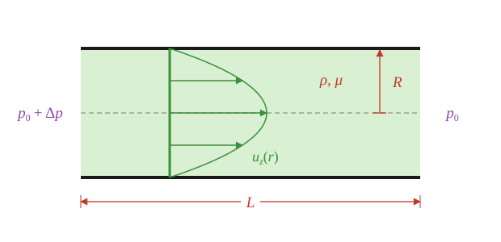

## The big idea

Last time we solved for [boundary- and pressure-driven flows between parallel plates](cartesian-flows.qmd). Most real flows don't happen between infinite flat plates: they go through round pipes, or around spinning shafts.

To analyze these problems, the strategy is the same, but we will be working in cylindrical coordinates. We assume **unidirectional flow**, consider the implications for conservation of mass, then cross out a lot of terms in the appropriate component of conservation of momentum, integrate twice, and use boundary conditions to determine values for the constants of integration.

## Think first

**Recall**

1. In the parallel-plate problems, which terms in the Navier-Stokes Equations went to zero, and why?
2. What is the no-slip condition? How many no-slip walls did the parallel-plate problems have?
3. What is $\int \frac{1}{r}\,dr$? What happens to it as $r\to 0$?

**Look ahead**

1. Fluid is pushed through a round pipe. Where is it fastest?
2. If you make a pipe's radius 10% smaller and keep the same pressure difference, do you think the flow rate drops by more than 10% or less than 10%?
3. The inner of two concentric cylinders spins and the outer one is held still. What do you think the fluid in the gap does?

## Cylindrical velocity components

In Cartesian coordinates, we represent a vector in terms of its $\mathbf{\hat{x}}$, $\mathbf{\hat{y}}$, and $\mathbf{\hat{z}}$ components:

$$
\mathbf{u}=\langle u_x, u_y, u_z \rangle. 
$$

The same vector can be represented in terms of an $\mathbf{\hat{r}}$ component (the component moving exactly away from the origin), a $\boldsymbol{\hat{\theta}}$ component (the component moving around the origin, getting no further or closer to the origin), and a $\mathbf{\hat{z}}$ component (same as in Cartesian).

$$
\mathbf{u} = \langle u_r, u_\theta, u_z\rangle.
$$

::: {.column-margin}
$u_\theta$ is a *speed* in the $\theta$-direction, so it has units of m/s. It is different from an angular velocity $\omega$, which has units of rad/s.
:::

::: {.callout-important}

Any vector $\mathbf{u}$ can be expressed in either coordinate system. However, we choose a particular representation based on mathematical convenience or intuition. A flow swirling around a point might have 

$$
\mathbf{u} = \langle u_r, u_\theta, u_z\rangle = \langle 0, 1/r, 0\rangle
$$

which could equivalently be represented as

$$
\mathbf{u} = \langle u_x, u_y, u_z\rangle = \langle \frac{-y}{x^2+y^2}, \frac{x}{x^2+y^2}, 0\rangle.
$$

The cylindrical representation is easier to manage mathematically, and we immediately see it is a swirling flow — there is only a $u_\theta$ component. The Cartesian one is tougher to deal with mathematically (imagine taking a derivative) and less intuitive.

:::

In this lesson we will study a couple problems that are more convenient to study in cylindrical coordinates.

## Pressure-driven flow in a cylindrical tube

A long tube of radius $R$ is filled with a fluid of density $\rho$ and viscosity $\mu$. We consider a pressure drop per length $\Delta p/L$ (same as in [the Cartesian case](cartesian-flows.qmd#pressure-driven-flow)). And, again like the Cartesian case, we'll assume the flow is **unidirectional**:

$$
\mathbf{u} = \langle u_r, u_\theta, u_z\rangle = \langle 0, 0, u_z\rangle.
$$

**Conservation of mass:**

::: {.callout-caution}

The gradient, divergence, curl, Laplacian, etc., have different representations in cylindrical coordinates.You do not have to memorize these, but if you use 

$$
\nabla\cdot\mathbf{u}=\frac{\partial u_r}{\partial r} + \frac{\partial u_\theta}{\partial \theta} + \frac{\partial u_z}{\partial z}
$$

**it is wrong**.

:::

The divergence in cylindrical coordinates is

$$
\nabla\cdot\mathbf{u} = 0 = \frac{1}{r}\frac{\partial}{\partial r}\left(r u_r\right) + \frac{1}{r}\frac{\partial u_\theta}{\partial \theta} + \frac{\partial u_z}{\partial z}.
$$

With the unidirectional assumption, $u_r=u_\theta=0$, and so this equation reduces to $\partial u_z/\partial z = 0$: the velocity profile does not change as we move along the pipe.

**Conservation of momentum in the $\mathbf{\hat{z}}$-direction:**

The full equation is

$$
\rho\left(\frac{\partial u_z}{\partial t} + u_r\frac{\partial u_z}{\partial r} + \frac{u_\theta}{r}\frac{\partial u_z}{\partial \theta} + u_z\frac{\partial u_z}{\partial z}\right) = -\frac{\partial p}{\partial z} + \mu\left[\frac{1}{r}\frac{\partial}{\partial r}\left(r\frac{\partial u_z}{\partial r}\right) + \frac{1}{r^2}\frac{\partial^2 u_z}{\partial \theta^2} + \frac{\partial^2 u_z}{\partial z^2}\right],
$$

but we will dramatically simplify this.

::: {.callout-important}

All of the following are zero, make sure you understand why!

- $\partial u_z/\partial t$: we assume steady flow.
- $u_r\,\partial u_z/\partial r$ and $(u_\theta/r)\,\partial u_z/\partial\theta$: unidirectional flow, $u_r=u_\theta=0$.
- $u_z\,\partial u_z/\partial z$ and $\partial^2 u_z/\partial z^2$: from conservation of mass, $\partial u_z/\partial z=0$.
- $\partial^2 u_z/\partial\theta^2$: we assume the flow is **axisymmetric**, so nothing depends on $\theta$.

:::

As before, the pressure drops by the same amount per length everywhere: $\partial p/\partial z = -\Delta p/L$. Writing $u \equiv u_z$, we are left with

$$
0 =\frac{\Delta p}{L} + \frac{\mu}{r}\frac{d}{dr}\left(r\frac{du}{dr}\right).
$$ {#eq-cyl-ode}

## Solve by integrating

Bring the $\Delta p$ term over, divide by $\mu$, multiply both sides by $r\,dr$, and integrate:

$$
\begin{align*}
&\int -\frac{\Delta p}{\mu L}\, r\,dr = \int d\left(r\frac{du}{dr}\right)\\
&\implies -\frac{1}{2}\frac{\Delta p}{\mu L}r^2 + c_1 = r\frac{du}{dr}.
\end{align*}
$$

Divide by $r$ and integrate again:

$$
\begin{align*}
&\int\left[-\frac{1}{2}\frac{\Delta p}{\mu L}r + \frac{c_1}{r}\right]dr = \int du\\
&\implies -\frac{1}{4}\frac{\Delta p}{\mu L}r^2 + c_1\ln r + c_2 = u.
\end{align*}
$$

## Boundary conditions

::: {.callout-important}

We only have one wall here, at $r=R$. That means we only have one no-slip surface. But we have two constants of integration to determine!

The key observation: we have a $c_1 \ln r$ term in our equation. What happens to this term when $r=0$? It blows up to $\pm \infty$! **The only way this can be avoided is if $c_1=0$.** We call this the "boundedness" condition, or say that "the flow must be physical". So our two boundary conditions are

- **BC1, no slip:** $u(r=R) = 0$.
- **BC2, "boundedness":** $u(r=0)$ is finite.

:::

So $c_1=0$, and then applying BC1 gives

$$
u(R) = 0 = -\frac{1}{4}\frac{\Delta p}{\mu L}R^2 + c_2 \implies c_2 = \frac{1}{4}\frac{\Delta p}{\mu L}R^2.
$$

Therefore

$$
u(r) = \frac{\Delta p\, R^2}{4\mu L}\left(1-\left(\frac{r}{R}\right)^2\right).
$$

The profile is parabolic.

## What is the maximum speed?

It occurs at the centerline:

$$
u_{\max} = \frac{\Delta p\, R^2}{4\mu L}.
$$

## What is the volumetric flow rate?

We need to integrate over the circular cross-section, which means $dA=r\,dr\,d\theta$:

$$
\begin{align*}
Q &= \int_0^{2\pi}\int_0^R u(r)\, r\,dr\,d\theta\\
&= 2\pi\cdot\frac{\Delta p\, R^2}{4\mu L}\int_0^R\left(r - \frac{r^3}{R^2}\right)dr\\
&= 2\pi\cdot\frac{\Delta p\, R^2}{4\mu L}\left(\frac{R^2}{2} - \frac{1}{4}\frac{R^4}{R^2}\right).
\end{align*}
$$

After simplifying:

$$
Q = \frac{\pi}{8}\frac{\Delta p\, R^4}{\mu L}.
$$

The $R^4$ means the flow rate is *very* sensitive to the radius!

## Example: a narrowed artery

We used the Buckingham-$\Pi$ Theorem to derive this result for $Q$ on [Homework 2, Problem 2](../../homework/hw2_sol.qmd#pressure-drop-scaling). The only thing we missed in that dimensional analysis was the numerical prefactor $\pi/8$.

Recall the consequence: if cholesterol reduces an artery's radius by 10%, it requires 52% more $\Delta p$ (from your heart) to achieve the same $Q$!

## Boundary-driven flow between rotating cylinders

Now for the cylindrical version of boundary-driven flow (sometimes called cylindrical Couette flow). Two long, concentric cylinders have fluid ($\rho$,$\mu$) in the gap between them. The inner cylinder has radius $R_\text{in}$ and spins with angular velocity $\Omega$ (units of rad/s); the outer cylinder has radius $R_\text{out}$ and is stationary. There is no applied pressure difference. This time the fluid goes *around*, so we assume

$$
\mathbf{u} = \langle u_r, u_\theta, u_z\rangle = \langle 0, u_\theta, 0\rangle.
$$

That is: it is **unidirectional** in the $\boldsymbol{\hat{\theta}}$ direction.

**Conservation of mass:**

The general conservation of mass statement is the same as above:

$$
\nabla\cdot\mathbf{u} = 0 = \frac{1}{r}\frac{\partial}{\partial r}\left(r u_r\right) + \frac{1}{r}\frac{\partial u_\theta}{\partial \theta} + \frac{\partial u_z}{\partial z}.
$$

With $u_r=u_z=0$, this reduces to $\partial u_\theta/\partial \theta = 0$: the velocity profile does not change as we move around the cylinder. We also may have recognized this without referencing conservation of mass: we could assume axisymmetry, in which case all $\partial/\partial\theta=0$.

**Conservation of momentum in the $\boldsymbol{\hat{\theta}}$-direction:**

The full equation is

$$
\begin{align*}
\rho\left(\frac{\partial u_\theta}{\partial t} + u_r\frac{\partial u_\theta}{\partial r} + \frac{u_\theta}{r}\frac{\partial u_\theta}{\partial \theta} + \frac{u_r u_\theta}{r} + u_z\frac{\partial u_\theta}{\partial z}\right)& = -\frac{1}{r}\frac{\partial p}{\partial \theta}\\
&+ \mu\left[\frac{\partial}{\partial r}\left(\frac{1}{r}\frac{\partial}{\partial r}\left(r u_\theta\right)\right) + \frac{1}{r^2}\frac{\partial^2 u_\theta}{\partial \theta^2} + \frac{2}{r^2}\frac{\partial u_r}{\partial \theta} + \frac{\partial^2 u_\theta}{\partial z^2}\right]
\end{align*}
$$

and we will dramatically simplify this one, too.

::: {.callout-important}

All of the following are zero, make sure you understand why!

- $\partial u_\theta/\partial t$: we assume steady flow.
- $u_r\,\partial u_\theta/\partial r$, $u_r u_\theta/r$, $(2/r^2)\,\partial u_r/\partial\theta$, and $u_z\,\partial u_\theta/\partial z$: we assumed $u_r=u_z=0$.
- $(u_\theta/r)\,\partial u_\theta/\partial\theta$ and $\partial^2 u_\theta/\partial\theta^2$: from conservation of mass, $\partial u_\theta/\partial\theta=0$.
- $\partial p/\partial\theta$: the flow is axisymmetric, and there is no applied pressure difference around the circle.
- $\partial^2 u_\theta/\partial z^2$: the cylinders are long, so nothing depends on $z$.

:::

Writing $u \equiv u_\theta$, we are left with

$$
0 = \frac{d}{dr}\left(\frac{1}{r}\frac{d}{dr}\left(r u\right)\right).
$$ {#eq-couette-ode}

## Solve by integrating

Integrate once:

$$
\begin{align*}
&\int 0\,dr = \int d\left(\frac{1}{r}\frac{d}{dr}\left(r u\right)\right)\\
&\implies c_1 = \frac{1}{r}\frac{d}{dr}\left(r u\right).
\end{align*}
$$

Multiply both sides by $r\,dr$ and integrate again:

$$
\begin{align*}
&\int c_1 r\,dr = \int d\left(r u\right)\\
&\implies \frac{1}{2}c_1 r^2 + c_2 = r u.
\end{align*}
$$

Dividing by $r$:

$$
u = \frac{1}{2}c_1 r + \frac{c_2}{r}.
$$

## Boundary conditions (again)

::: {.callout-important}

This time we have two walls, and so two no-slip surfaces. The velocity at the inner wall (with dimensions of L/T) is $\Omega R_\text{in}$; the outer wall is stationary:

- **BC1, no slip on the inner cylinder:** $u(r=R_\text{in}) = \Omega R_\text{in}$.
- **BC2, no slip on the outer cylinder:** $u(r=R_\text{out}) = 0$.

What about the $c_2/r$ term blowing up at $r=0$? It doesn't matter here... $r=0$ is inside the inner cylinder, not in the fluid. So we don't need the boundedness condition.

:::

Writing the system of equations:

$$
\begin{align*}
u(R_\text{in}) =&\, \Omega R_\text{in} = \frac{1}{2}c_1 R_\text{in} + \frac{c_2}{R_\text{in}}\\
u(R_\text{out}) =&\, 0 = \frac{1}{2}c_1 R_\text{out} + \frac{c_2}{R_\text{out}}
\end{align*}
$$

we find

$$
\frac{1}{2}c_1 = -\frac{\Omega R_\text{in}^2}{R_\text{out}^2 - R_\text{in}^2}, \qquad c_2 = \frac{\Omega R_\text{in}^2 R_\text{out}^2}{R_\text{out}^2 - R_\text{in}^2}.
$$

Therefore

$$
u_\theta(r) = \frac{\Omega R_\text{in}^2}{R_\text{out}^2 - R_\text{in}^2}\left(\frac{R_\text{out}^2}{r} - r\right).
$$

<!-- ## Does this make sense?

This result is a bit more complicated mathematically — it is harder to just look at it and say it is right.

Two checks.

**A thin gap.** If the gap $h = R_\text{out} - R_\text{in}$ is small compared to $R_\text{in}$, the curvature shouldn't matter much, and we should get back the Cartesian boundary-driven result. Writing $r = R_\text{in} + y$ and keeping only the leading terms in $h/R_\text{in}$:

$$
u_\theta \approx \Omega R_\text{in}\left(1 - \frac{y}{h}\right),
$$

a straight line from the wall speed $\Omega R_\text{in}$ down to zero, just like [the Cartesian case](cartesian-flows.qmd) (flipped, since here the *inner* wall moves).

**No outer wall.** If $R_\text{out}\to\infty$, the result becomes

$$
u_\theta = \frac{\Omega R_\text{in}^2}{r},
$$

which is the $1/r$ swirling flow from the start of this lesson. -->
