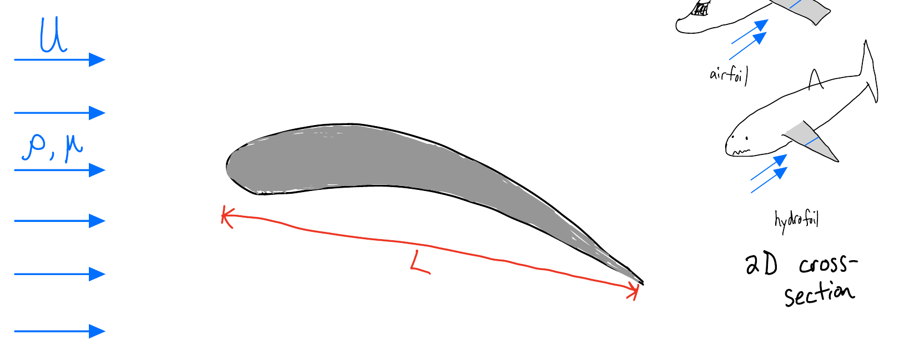

## The big idea

There are few cases in which we can solve the Navier-Stokes Equations (NSE) exactly, mostly "unidirectional flows". In this class of flows, the nonlinear term $(\mathbf{u}\cdot\nabla)\mathbf{u}$ becomes zero. The NSE in the flow direction turns into a linear ODE, and we can solve it.

Aside from these special cases, the Navier-Stokes Equations, in their full form, are practically unsolvable because of that nonlinear term.

## Introduction to approximate solutions

Another approach: find a way to argue that certain terms in the NSE are negligible, and then the "approximate equation" is more tractable. It is typical to look through the prism of the Reynolds number:

$$
Re = \frac{\rho U L}{\mu} = \frac{\rho U^2}{\mu U/L}=\frac{\text{momentum}}{\text{viscous dissipation}}
$$

$\text{Re}$ is a ratio of momentum to dissipation, and we can often estimate it at the start of a problem.

### Calculating Re

The largest dimension of the object (e.g. the pipe diameter or "chord length" from leading to trailing edge on an airfoil) is taken as $L$, the incoming flow speed or average flow speed is $U$, and the fluid is known so $\rho$ and $\mu$ are known. Sometimes we are not given an incoming flow speed, but maybe we are given a frequency or time: we can create a quantity with dimensions of speed to estimate the Reynolds Number, e.g. calling the characteristic speed $U=\omega L$.

If we find $\text{Re}\ll 1$, we are in the "low Reynolds Number regime", and we proceed with an analysis using "The Stokes Equations". If we find $\text{Re}\gg 1$ we are in the "high Reynolds Number regime" and proceed with an analysis using "The Euler Equations", Bernoulli's Equation, and considerations of boundary layers, wakes, and turbulence.

### Low Reynolds number

::: {.callout-note}

We will not be solving "The Stokes Equations" or "The Euler Equations" in this class, though I might include a potential flow problem on the next homework. This section is mostly about making you aware of what can be solved, if you dive into the math of fluid mechanics.

:::

**Claim:** If $Re \ll 1$, inertia is negligible.

$$
\underbrace{\rho\frac{D\mathbf{u}}{Dt}}_{\approx 0} = -\nabla p + \mu\nabla^2\mathbf{u}.
$$

"The Stokes Equations" are $0=-\nabla p + \mu\nabla^2\mathbf{u}$ (with $\nabla\cdot\mathbf{u}=0$). These are coupled linear PDEs and there are many solution strategies (beyond the level of this class). For example, we can use the Stokes Equations to determine the solution for flow around a sphere:

$$
\begin{align*}
u_r &= U\cos\theta\left(1 - \frac{3R}{2r} + \frac{R^3}{2r^3}\right)\\
u_\theta &= -U\sin\theta\left(1 - \frac{3R}{4r} - \frac{R^3}{4r^3}\right)\\
p &= p_\infty - \frac{3\mu U R}{2r^2}\cos\theta
\end{align*}
$$

for a sphere of radius $R$ in a uniform stream of speed $U$, using spherical coordinates. Integrating the pressure and viscous stresses over the sphere's surface gives the drag force, known as **Stokes drag**: $F_D = 6\pi\mu U R$.

**Example when this occurs:** *H. pylori* bacteria swimming in the stomach.

$$
Re = \frac{\left(1000\ \tfrac{\text{kg}}{\text{m}^3}\right)\left(10^{-5}\ \tfrac{\text{m}}{\text{s}}\right)\left(10^{-5}\ \text{m}\right)}{\left(1\ \text{Pa}\cdot\text{s}\right)} = 10^{-7}.
$$

Very low Reynolds Number, and so we might study this flow using Stokes Equations. Further, we know that high Reynolds Number phenomena such as turbulence and wakes are not relevant to swimming bacteria because $\text{Re}\ll 1$.

### High Reynolds number

**Claim:** If $Re \gg 1$, viscosity is *probably* negligible (more on this soon).

$$
\rho\frac{D\mathbf{u}}{Dt} = -\nabla p + \underbrace{\mu\nabla^2\mathbf{u}}_{\approx 0} + \rho\mathbf{g}
$$

"The Euler Equations" are $\rho\frac{D\mathbf{u}}{Dt} = -\nabla p + \rho\mathbf{g}$. These are still nonlinear PDEs, so they are hard to solve directly. However, it can be shown that: if $\mu = 0$ and the incoming flow has no rotation (e.g. a uniform stream), then $\nabla\times\mathbf{u} = 0$ everywhere. We call vector fields with zero curl "conservative" or "potential" fields, and they can be written as $\mathbf{u} = \nabla\phi$, where $\phi$ is the "velocity potential". Plugging this into conservation of mass gives

$$
\nabla\cdot\mathbf{u} = 0 \implies \nabla\cdot\nabla\phi = 0 \implies \nabla^2\phi = 0.
$$

This is a classical linear PDE (Laplace's equation) with many solution strategies. This is the equation that is solved in [the airfoil simulation](../unit-3/joukowski.qmd#the-demo).

Potential flow works well for streamlined bodies (like the airfoil), but it does not predict wakes or turbulence or drag! We need to consider "boundary layer" physics. Namely, we hypothesize that, near surfaces (within 1 cm or so), viscosity actually is important.

## Boundary layers

Before getting back into the math, let's give a bit of history. We learned about [d'Alembert's Paradox](../unit-3/lift-drag.qmd#the-pressure-on-the-surface), which is essentially the claim that there is no drag at high Reynolds Number. If a fluid has no viscosity, as we (naively) approximate at high Reynolds Number, there is no no-slip condition... but intuitively, we'd expect there to be some "grab" at surfaces, even if the flow is fast. In 1904, Prandtl published a paper describing the **boundary layer**: a thin region near surfaces where viscosity is important. Thus, no slip is relevant.

After some careful consideration of the magnitude of terms, we can write "The Bounday Layer Equations":

$$
\begin{align*}
\frac{\partial u}{\partial x} + \frac{\partial v}{\partial y} &= 0\\
\rho\left(u\frac{\partial u}{\partial x} + v\frac{\partial u}{\partial y}\right)&= -\frac{\partial p}{\partial x} + \mu \frac{\partial^2 u}{\partial y^2}\\
0 &= -\frac{\partial p}{\partial y}.
\end{align*}
$$

These are an approximate form of the Navier-Stokes Equations. The key assumption in arriving at these equations is that the boundary layer region is thin. Then we'd expect

$$
\frac{\partial u}{\partial y} \gg \frac{\partial u}{\partial x}.
$$

Thus, we keep the $\partial^2 u/\partial y^2$ term in these equations, but neglect $\partial^2 u/\partial x^2$.

The bad news: these equations are still nonlinear, and so we can't solve to get an analytical expression for $\mathbf{u}(x,y)$. The good news: for many model geometries, these equations can be solved numerically.

We'll talk about some practicalities in the [boundary layer reading](boundary-layers.qmd).

<!-- {width=100% fig-alt="Uniform flow with speed U, density ρ, and viscosity μ approaching an airfoil of chord length L. Insets: an airplane wing (airfoil) and a shark fin (hydrofoil), each a 2D cross-section."}

$$
Re_L \approx \frac{\left(1\ \tfrac{\text{kg}}{\text{m}^3}\right)\left(200\ \tfrac{\text{m}}{\text{s}}\right)\left(1\ \text{m}\right)}{10^{-5}\ \text{Pa}\cdot\text{s}} \rightarrow 2\times 10^{7} \quad \text{(high!)}
$$

It actually is not unreasonable to take $\mu = 0$ and analyze this using tools like Bernoulli's Equation — the shape is "streamlined", so there is little separation. This gives a good estimate of lift, but predicts *zero* drag!

- Consider details near the surface. -->