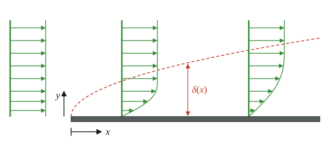
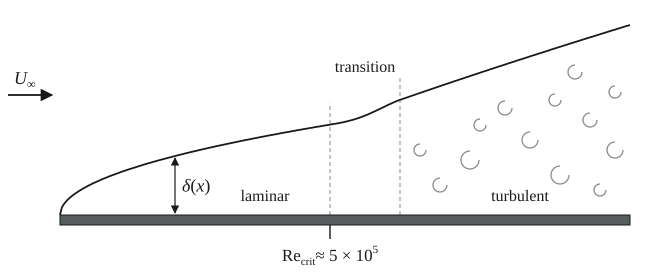




## Big picture

I recommend reading [Approximate solutions to the NSE](approx-NSE.qmd) first. There, we introduce the idea of simplifying the Navier-Stokes Equations to get a set of equations that are approximate, but easier to analyze.

The **boundary layer** is a region very near surfaces (within a centimeter or so) where *viscosity is important* (even though the flow is $\text{Re}>1000$, suggesting that momentum is $1000\times$ more significant than viscous dissipation). This idea helps us to understand why high-speed flows have drag, why flow separation occurs, and why wakes exist. 

## Boundary layers

Let's start with the simplest configuration: the "Flat Plate Boundary Layer".

{width=100% fig-alt="Flat plate boundary layer. A uniform velocity profile approaches a flat plate whose leading edge is at the origin of the x-y axes. Two velocity profiles on the plate go from zero at the surface to the free-stream speed. A dashed curve marks the boundary layer thickness δ(x), which grows with distance x along the plate; the downstream profile is thicker."}


Flow enters from the left with uniform speed $U$ (in $\boldsymbol{\hat{x}}$). It encounters a flat plate with its *leading edge* at $x=0$. The no-slip condition occurs at the surface, meaning $u(x>0,y=0)=0$. That is: at the surface we have zero speed, and far above the surface the flow is still at $U$. So we have a velocity distribution that spans $0\rightarrow U$.

How far above the plate do we need to be for the flow to still be at $U$? We can use a scaling analysis to determine the **boundary layer thickness** $\delta$ (a distance). We expect it to depend on where we are along the plate and on the flow (the influence of the wall diffuses upwards as the flow progresses), so for starters we will think about $\delta(x, U, \rho, \mu)$.

For each checkpoint below: enter **+1** if $\delta$ increases, **−1** if $\delta$ decreases, or **0** if it has no effect.

```{=html}
<div class="fl-checkpoint"
     data-prompt="Moving farther downstream, increasing <i>x</i> (everything else fixed) — effect on <i>&#948;</i>?"
     data-answer="1" data-tol="0.01" data-units=""
     data-hint="The farther downstream we go, the longer the fluid has been in contact with the plate, being slowed down by it."
     data-target="bl-scaling-U"></div>
```

::: {#bl-scaling-U .fl-hidden}
```{=html}
<div class="fl-checkpoint"
     data-prompt="Increasing the free stream speed <i>U</i> (everything else fixed) — effect on <i>&#948;</i>?"
     data-answer="-1" data-tol="0.01" data-units=""
     data-hint="Faster flow sweeps fluid past a given spot on the plate before the wall's slowing-down influence has much time to spread upward."
     data-target="bl-scaling-mu"></div>
```
:::

::: {#bl-scaling-mu .fl-hidden}
```{=html}
<div class="fl-checkpoint"
     data-prompt="Increasing the viscosity <i>&#956;</i> (everything else fixed) — effect on <i>&#948;</i>?"
     data-answer="1" data-tol="0.01" data-units=""
     data-hint="Viscosity is how the wall 'talks' to the fluid above it. A plate dragged through honey hauls a lot more fluid along with it than one dragged through water."
     data-target="bl-scaling-rho"></div>
```
:::

::: {#bl-scaling-rho .fl-hidden}
```{=html}
<div class="fl-checkpoint"
     data-prompt="Increasing the density <i>&#961;</i>, holding <i>&#956;</i> fixed — effect on <i>&#948;</i>?"
     data-answer="-1" data-tol="0.01" data-units=""
     data-hint="Denser fluid has more inertia, so the same viscous stress from the wall has a harder time slowing it down."
     data-ok-text="&#10003; correct — that's everything we need."
     data-target="bl-scaling-combine"></div>
```
:::

::: {#bl-scaling-combine .fl-hidden}
The boundary layer thickness $\delta$ increases with...

- increasing distance along the plate $x$, as the effect on the flow takes some time to diffuse from the surface.
- decreasing free stream speed $U$. The advection downstream is competing with the diffusion perpendicular to the flow, so faster flow means $\delta$ grows more slowly.
- increasing value of $\mu$ — the plate more easily "grabs flow".
- decreasing value of $\rho$ — "heavier" fluids have more inertia, and so slowing them down is more difficult.


Then, via a scaling analysis,

$$
\delta \sim \sqrt{\frac{\mu x}{\rho U}}
$$

which can be rewritten as

$$
\frac{\delta}{x} \sim \sqrt{\frac{\mu}{\rho U x}}=\frac{1}{\sqrt{Re_x}}.
$$

The Boundary Layer Equations (from [the previous reading](approx-NSE.qmd))

$$
\begin{align*}
\frac{\partial u}{\partial x} + \frac{\partial v}{\partial y} &= 0\\
\rho\left(u\frac{\partial u}{\partial x} + v\frac{\partial u}{\partial y}\right)&= -\frac{\partial p}{\partial x} + \mu \frac{\partial^2 u}{\partial y^2}\\
0 &= -\frac{\partial p}{\partial y}.
\end{align*}
$$

can be solved numerically, and we find 

::: {.column-margin}
The numerical solution for the flat plate is called the "Blasius Boundary Layer".
:::

$$
\frac{\delta}{x} \approx \frac{5.0}{\sqrt{Re_x}}, \qquad Re_x = \frac{Ux}{\nu} = \frac{\rho U x}{\mu}.
$$
:::


We can also use the numerical solution to determine the drag force via

$$
F_D = \int_0^w\!\!\int_0^L \tau(x, 0, z)\, dx\, dz \qquad \text{with} \qquad \tau = \mu\frac{\partial u}{\partial y}.
$$

We'll talk about how it is catalogued in the next section.

## Boundary layer evolution

{width=100% fig-alt="Boundary layer over a flat plate with free stream U∞. The boundary layer thickness δ(x) grows like the square root of x in the laminar region, thickens quickly through a transition region that begins at Re_crit ≈ 5×10^5, and then grows faster in the turbulent region, which is filled with eddies."}

In all flow geometries (flat plate BL, flow over a sphere, pipe flow, etc.) the transition to turbulence occurs at a critical value of $\text{Re}$. For a flat plate, we define the Reynolds Number based on the distance from the leading edge, and the critical value is

$$
\text{Re}_x \equiv \frac{\rho U x}{\mu}, \qquad \text{Re}_\text{crit} \approx 5\times 10^5.
$$

After the transition to turbulence, the flow becomes completely three-dimensional. Consequently, the boundary layer thickness grows at a greater rate ($\sim x^{4/5}$) and the gradient of the (average) velocity becomes steeper at the plate's surface. The latter implies a greater shear stress at the surface (greater drag).


## Determining drag on a flat surface

For the problem of determining the drag, with turbulence and surface roughness being posibly relevant, we look to Buckingham-$\Pi$ to catalog the results. Our relevant parameters are 

- $F_\text{D}$, the drag force.
- $L$, the distance from the leading edge.
- $w$, the plate width.
- $\mu$
- $\rho$
- $U$
- and $\epsilon$, the surface roughness, typically measured in mm.

That is: $n=7$ parameters/variables, and it will take $n=3$ fundamental dimensions to describe them. From Buckingham-$\Pi$, we should expect $n-r=4$ independent dimensionless groups. They are

Dimensionless groups:

- The Reynolds number: $\text{Re}_L \equiv \frac{\rho U L}{\mu}$
- The friction coefficient: $\displaystyle C_\text{f} \equiv \frac{F_D}{\tfrac{1}{2}\rho U^2 \cdot L\cdot w}$
- The relative roughness: $\epsilon/L$
- The aspect ratio: $w/L$ (which we assume is not relevant to the physics).

That is:

$$
\implies C_f\left(\text{Re}_L, \frac{\epsilon}{L}\right).
$$

Here are some typical values for $\epsilon$:


| Material          | Roughness $\epsilon$ [mm] |
|-------------------|---------------------------|
| Riveted steel     | 0.9–9.0                   |
| Concrete          | 0.3–3.0                   |
| Wood stave        | 0.18–0.9                  |
| Cast iron         | 0.26                      |
| Galvanized iron   | 0.15                      |
| Commercial steel  | 0.045                     |
| Drawn tubing      | 0.0015                    |
| Plastic, glass    | $\sim 0$                  |

e.g. for a $L = 1$ m patch of concrete

$$
\frac{\epsilon}{L} = \frac{1\ \text{mm}}{1\ \text{m}} = 0.001.
$$

And here are correlations for the friction coefficient:

| $C_f$                                                  | Regime                                         |
|--------------------------------------------------------|------------------------------------------------|
| $1.328/Re_L^{0.5}$                                     | laminar flow                                   |
| $0.455/(\log Re_L)^{2.58} - 1700/Re_L$                 | transitional ($5\times 10^5 \pm 10\%$?)        |
| $0.455/(\log Re_L)^{2.58}$                             | turbulent                                      |
| $\left[1.89 - 1.62\log\left(\frac{\epsilon}{L}\right)\right]^{-2.5}$ | turbulent due to roughness       |

(Here $\log$ is base 10.)