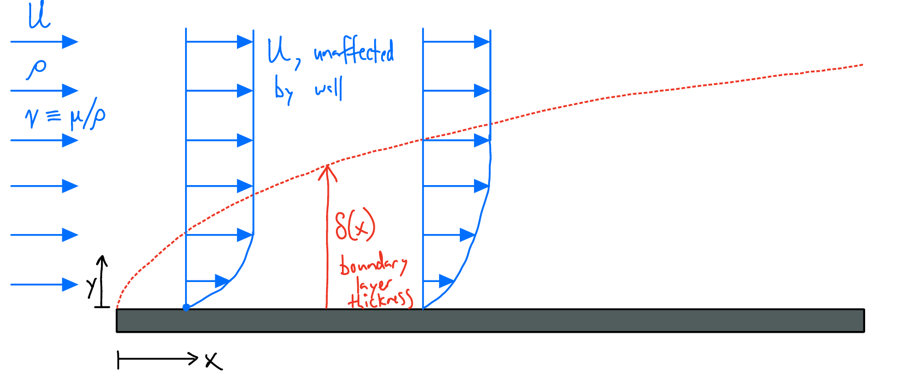
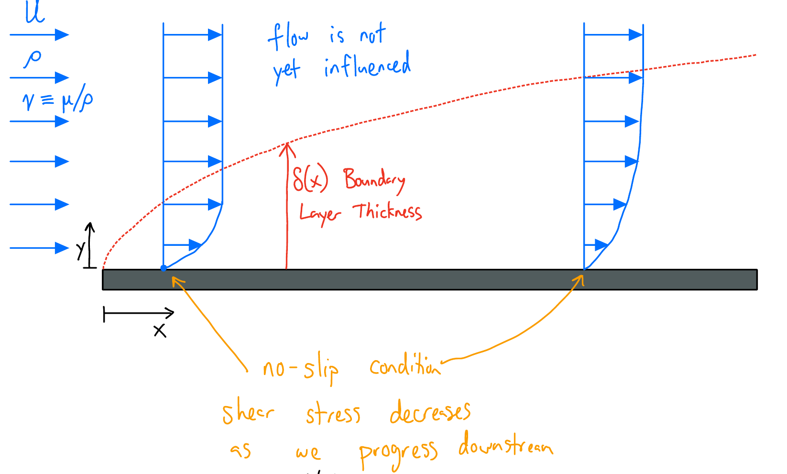
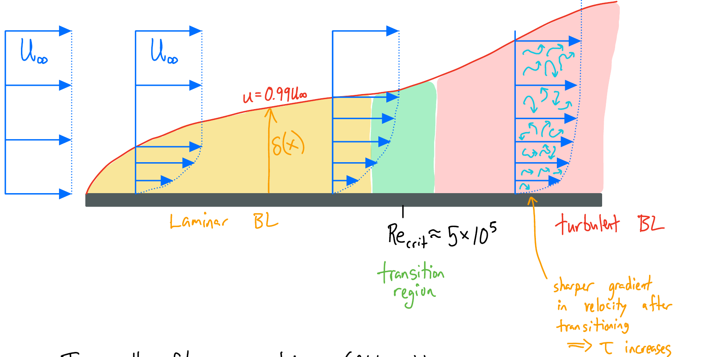
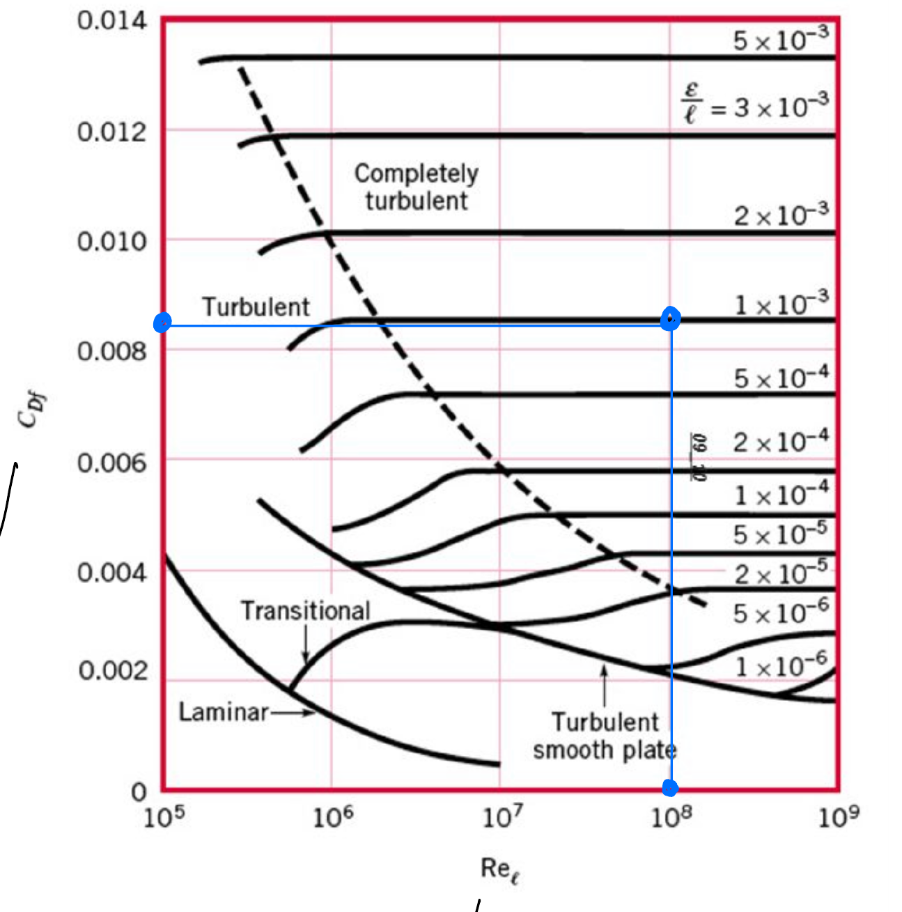




<!-- The simplest configuration is the flat plate boundary layer:

{width=100% fig-alt="Flat plate boundary layer. Uniform flow U (density ρ, kinematic viscosity ν ≡ μ/ρ) approaches a flat plate starting at x = 0. Velocity profiles show U unaffected by the wall far above, slowing to zero at the plate. A dashed curve marks the boundary layer thickness δ(x), which grows with x."}

The boundary layer thickness $\delta$ increases with...

- increasing distance along the plate $x$,
- increasing value of $\nu \equiv \mu/\rho$ (kinematic viscosity) — the plate more easily "grabs flow",
- decreasing free stream speed $U$.

Dimensional analysis $\rightarrow$

$$
\frac{\delta}{x} \sim \frac{1}{\sqrt{Re_x}}
$$

and from computations

$$
\frac{\delta}{x} \approx \frac{5.0}{\sqrt{Re_x}}, \qquad Re_x = \frac{Ux}{\nu} = \frac{\rho U x}{\mu}.
$$ -->


## Big picture

I recommend reading [Approximate solutions to the NSE](approx-NSE.qmd) first. There, we introduce the idea of simplifying the Navier-Stokes Equations to get a set of equations that are approximate, but easier to analyze.

The **boundary layer** is a region very near surfaces (within a centimeter or so) where *viscosity is important* (even though we might calculate $\text{Re}\approx 3000$, suggesting inertia is 3000 times more important than viscous dissipation). This idea helps us to understand why high-speed flows have drag, why flow separation occurs, and why wakes exist. 

## Boundary layers

Let's start with the simplest configuration: the "Flat Plate Boundary Layer".

{width=100% fig-alt="Flat plate boundary layer. Uniform flow U (density ρ, kinematic viscosity ν ≡ μ/ρ). Above the dashed boundary layer thickness δ(x), the flow is not yet influenced. Velocity is zero at the plate (no-slip condition). Shear stress decreases as we progress downstream."}


Flow enters from the left with uniform speed $U$ (in $\boldsymbol{\hat{x}}$). It encounters a flat plate with its *leading edge* at $x=0$. The no-slip condition occurs at the surface, meaning $u(x>0,y=0)=0$. That is: at the surface we have zero speed, and far above the surface the flow is still at $U$, and so we have a velocity distribution $0\rightarrow U$.

How far above the plate do we need to be for the flow to still be at $U$? We can use a scaling analysis to determine the **boundary layer thickness** $\delta$ (a distance). We expect it to depend on where we are along the plate and on the flow (the influence of the wall diffuses upwards as the flow progresses), so for starters we will think about $\delta(x, U, \rho, \mu)$.

For each checkpoint below: enter **+1** if $\delta$ increases, **−1** if $\delta$ decreases, or **0** if it has no effect.

```{=html}
<div class="fl-checkpoint"
     data-prompt="Moving farther downstream, increasing <i>x</i> (everything else fixed) — effect on <i>&#948;</i>?"
     data-answer="1" data-tol="0.01" data-units=""
     data-hint="The farther downstream we go, the longer the fluid has been in contact with the plate, being slowed down by it."
     data-target="bl-scaling-U"></div>
```

::: {#bl-scaling-U .fl-hidden}
```{=html}
<div class="fl-checkpoint"
     data-prompt="Increasing the free stream speed <i>U</i> (everything else fixed) — effect on <i>&#948;</i>?"
     data-answer="-1" data-tol="0.01" data-units=""
     data-hint="Faster flow sweeps fluid past a given spot on the plate before the wall's slowing-down influence has much time to spread upward."
     data-target="bl-scaling-mu"></div>
```
:::

::: {#bl-scaling-mu .fl-hidden}
```{=html}
<div class="fl-checkpoint"
     data-prompt="Increasing the viscosity <i>&#956;</i> (everything else fixed) — effect on <i>&#948;</i>?"
     data-answer="1" data-tol="0.01" data-units=""
     data-hint="Viscosity is how the wall 'talks' to the fluid above it. A plate dragged through honey hauls a lot more fluid along with it than one dragged through water."
     data-target="bl-scaling-rho"></div>
```
:::

::: {#bl-scaling-rho .fl-hidden}
```{=html}
<div class="fl-checkpoint"
     data-prompt="Increasing the density <i>&#961;</i>, holding <i>&#956;</i> fixed — effect on <i>&#948;</i>?"
     data-answer="-1" data-tol="0.01" data-units=""
     data-hint="Denser fluid has more inertia, so the same viscous stress from the wall has a harder time slowing it down."
     data-ok-text="&#10003; correct — that's everything we need."
     data-target="bl-scaling-combine"></div>
```
:::

::: {#bl-scaling-combine .fl-hidden}
The boundary layer thickness $\delta$ increases with...

- increasing distance along the plate $x$,
- increasing value of $\nu \equiv \mu/\rho$ (kinematic viscosity) — the plate more easily "grabs flow",
- decreasing free stream speed $U$.

Then, via a scaling analysis,

$$
\frac{\delta}{x} \sim \frac{1}{\sqrt{Re_x}}.
$$

The Boundary Layer Equations (from [the previous reading](approx-NSE.qmd))

$$
\begin{align*}
\frac{\partial u}{\partial x} + \frac{\partial v}{\partial y} &= 0\\
\rho\left(u\frac{\partial u}{\partial x} + v\frac{\partial u}{\partial y}\right)&= -\frac{\partial p}{\partial x} + \mu \frac{\partial^2 u}{\partial y^2}\\
0 &= -\frac{\partial p}{\partial y}.
\end{align*}
$$

can be solved numerically, and we find 

::: {.column-margin}
The numerical solution for the flat plate is called the "Blasius Boundary Layer".
:::

$$
\frac{\delta}{x} \approx \frac{5.0}{\sqrt{Re_x}}, \qquad Re_x = \frac{Ux}{\nu} = \frac{\rho U x}{\mu}.
$$
:::


We can also use the numerical solution to determine the drag force via


$$
F_D = \int_0^w\!\!\int_0^L \tau(x, 0, z)\, dx\, dz \qquad \text{with} \qquad \tau = \mu\frac{\partial u}{\partial y}
$$


## Boundary layer physics: $Re \gtrsim 1000$

{width=100% fig-alt="Boundary layer over a flat plate with free stream U∞. The edge of the boundary layer δ(x) is where u = 0.99 U∞. A laminar boundary layer (yellow) is followed by a transition region (green) near Re_crit ≈ 5×10^5 and then a turbulent boundary layer (red) with eddies. The turbulent profile has a sharper gradient in velocity after transitioning, so τ increases."}

In all flow geometries (flat plate BL, flow over a sphere, pipe flow, etc.) the transition to turbulence occurs at a critical value of $Re$. For a flat plate,

$$
Re_x \equiv \frac{\rho U x}{\mu}, \qquad Re_\text{crit} \approx 5\times 10^5,
$$

where $x$ is the distance from the leading edge.

## Boundary layer practicalities — determining drag on a flat surface

Relevant: $F_D$, $L$, $w$, $\mu$, $\rho$, $U$, $\epsilon$ (surface roughness, [mm]).

$$
\left.\begin{aligned} n &= 7 \\ r &= 3 \end{aligned}\right\} \rightarrow 4 \text{ independent dimensionless groups}
$$

Dimensionless groups:

- The Reynolds number: $\displaystyle Re_L \equiv \frac{\rho U L}{\mu}$
- The friction coefficient: $\displaystyle C_f \equiv \frac{F_D}{\tfrac{1}{2}\rho U^2 \cdot L\cdot w}$
- The relative roughness: $\displaystyle \frac{\epsilon}{L}$
- The aspect ratio: $\displaystyle \frac{w}{L}$ (assume not relevant)

$$
\implies C_f\left(Re_L, \frac{\epsilon}{L}\right)
$$

| Material          | Roughness $\epsilon$ [mm] |
|-------------------|---------------------------|
| Riveted steel     | 0.9–9.0                   |
| Concrete          | 0.3–3.0                   |
| Wood stave        | 0.18–0.9                  |
| Cast iron         | 0.26                      |
| Galvanized iron   | 0.15                      |
| Commercial steel  | 0.045                     |
| Drawn tubing      | 0.0015                    |
| Plastic, glass    | $\sim 0$                  |

e.g. concrete, $L = 1$ m patch:

$$
\frac{\epsilon}{L} = \frac{1\ \text{mm}}{1\ \text{m}} = 0.001
$$

| $C_f$                                                  | Regime                                         |
|--------------------------------------------------------|------------------------------------------------|
| $1.328/Re_L^{0.5}$                                     | laminar flow                                   |
| $0.455/(\log Re_L)^{2.58} - 1700/Re_L$                 | transitional ($5\times 10^5 \pm 10\%$?)        |
| $0.455/(\log Re_L)^{2.58}$                             | turbulent                                      |
| $\left[1.89 - 1.62\log\left(\frac{\epsilon}{L}\right)\right]^{-2.5}$ | turbulent due to roughness       |

Here $\log$ is base 10.

Or: from a chart.

{width=80% fig-alt="Friction coefficient C_Df versus Re_ℓ from 10^5 to 10^9 for a flat plate, with curves for laminar, transitional, turbulent smooth plate, and completely turbulent flow at relative roughness ε/ℓ from 1×10^-6 to 5×10^-3. An example reading at Re_ℓ = 10^8 and ε/ℓ = 1×10^-3 gives C_Df ≈ 0.0085."}

Compute $Re_L = \dfrac{\rho\cdot U\cdot L}{\mu}$ to read the chart, then unpack

$$
C_f = \frac{F_D}{\tfrac{1}{2}\rho U^2\cdot w\cdot L}
$$

to get $F_D$ in Newtons.