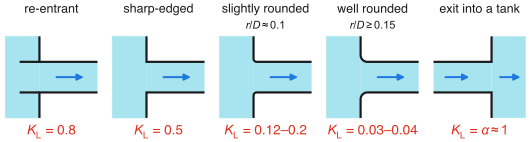
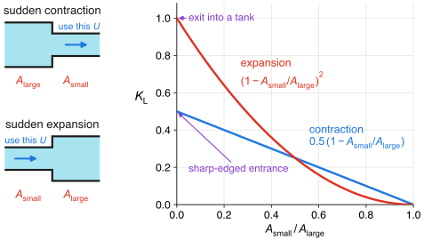
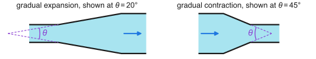

A lookup page. Every value here goes into

$$
h_\text{L,minor} = K_\text{L}\,\frac{U^2}{2g},
$$

with $U$ the speed in the attached pipe (or in the *smaller* pipe, when the size changes). These are typical values for turbulent flow, and they're rough: expect up to ±50% between manufacturers, and don't be shocked when two textbooks disagree about the same elbow. If you have the manufacturer's number for your actual part, use that.

## Entrances and exits

{#fig-entrances width=100% fig-alt="Five cross-sections. Re-entrant entrance, pipe protruding into the tank: K_L = 0.8. Sharp-edged entrance: K_L = 0.5. Slightly rounded entrance, r/D about 0.1: K_L = 0.12 to 0.2. Well rounded entrance, r/D at least 0.15: K_L = 0.03 to 0.04. Pipe exit into a tank: K_L = alpha, about 1."}

The exit is the kinetic-energy correction factor $\alpha$, since all of the pipe's kinetic energy gets dissipated in the tank: about 1 for turbulent flow, and 2 for laminar.

## Sudden area changes

These depend on the area ratio. Use the speed in the smaller pipe for both.

{#fig-area-change width=100% fig-alt="Schematics of a sudden contraction and a sudden expansion, with the speed U taken in the smaller pipe, next to a plot of K_L versus area ratio from 0 to 1. The expansion curve falls from 1 to 0 as (1 minus area ratio) squared. The contraction line falls from 0.5 to 0 as 0.5 times (1 minus area ratio). They cross at area ratio 0.5."}

| $A_\text{small}/A_\text{large}$ | 0 | 0.2 | 0.4 | 0.6 | 0.8 | 1 |
|:--|:-:|:-:|:-:|:-:|:-:|:-:|
| Contraction, $K_\text{L}\approx 0.5\,(1-A_\text{small}/A_\text{large})$ | 0.50 | 0.40 | 0.30 | 0.20 | 0.10 | 0 |
| Expansion, $K_\text{L}= (1-A_\text{small}/A_\text{large})^2$ | 1.00 | 0.64 | 0.36 | 0.16 | 0.04 | 0 |

The expansion is one of the few entries we can actually derive (with mass, momentum, and energy). The contraction is empirical, and other fits exist.^[White's fit, for example, is $K_\text{L}\approx 0.42\,(1-d^2/D^2)$ for $d/D\leq 0.76$, switching to the expansion formula for larger $d/D$. Remember that $d^2/D^2$ is the same thing as the area ratio.]

## Gradual area changes

Easing into the change helps a lot, especially for contractions. Again, use the speed in the smaller pipe.

{#fig-gradual width=100% fig-alt="Two cross-sections with the cone walls extended by dashed lines to an apex on the centerline. The angle between the dashed lines is the included angle theta. A gradual expansion is drawn at theta = 20 degrees, and a gradual contraction at theta = 45 degrees."}

::: {layout-ncol=2}

| Expansion, $\theta=20°$: $d/D$ | $K_\text{L}$ |
|:--|:-:|
| 0.2 | 0.30 |
| 0.4 | 0.25 |
| 0.6 | 0.15 |
| 0.8 | 0.10 |

| Contraction: $\theta$ | $K_\text{L}$ |
|:--|:-:|
| 30° | 0.02 |
| 45° | 0.04 |
| 60° | 0.07 |

:::

## Bends, elbows, and tees

| Fitting | Flanged | Threaded | Mitered (no fitting) |
|:--|:-:|:-:|:-:|
| 90° elbow, regular | 0.3 | 1.5 | |
| 90° elbow, long radius | 0.2 | 0.7 | |
| 90° miter bend, no vanes | | | 1.1 |
| 90° miter bend, with vanes | | | 0.2 |
| 45° elbow, regular | | 0.4 | |
| 45° elbow, long radius | 0.2 | | |
| 180° return bend | 0.2 | 1.5 | |
| Tee, line flow (straight through) | 0.2 | 0.9 | |
| Tee, branch flow (turning the corner) | 1.0 | 2.0 | |
| Union | | 0.08 | |

## Valves

| Valve | Opening | $K_\text{L}$ |
|:--|:--|:-:|
| Globe | fully open | 10 |
| Angle | fully open | 2 |
| Gate | fully open | 0.15 |
| | ¼ closed | 0.26 |
| | ½ closed | 2.1 |
| | ¾ closed | 17 |
| Ball | fully open | 0.05 |
| | ⅓ closed | 5.5 |
| | ⅔ closed | 210 |
| Swing check | forward flow | 2 |
| | backward flow | ∞ (that's its job) |

## Size matters

Those single numbers hide a real trend: small fittings are generally worse. Here's the same hardware across nominal pipe sizes.

**Threaded**

| Fitting | ½ in | 1 in | 2 in | 4 in |
|:--|:-:|:-:|:-:|:-:|
| Globe valve, open | 14 | 8.2 | 6.9 | 5.7 |
| Gate valve, open | 0.30 | 0.24 | 0.16 | 0.11 |
| Swing check, open | 5.1 | 2.9 | 2.1 | 2.0 |
| Angle valve, open | 9.0 | 4.7 | 2.0 | 1.0 |
| 45° elbow, regular | 0.39 | 0.32 | 0.30 | 0.29 |
| 90° elbow, regular | 2.0 | 1.5 | 0.95 | 0.64 |
| 90° elbow, long radius | 1.0 | 0.72 | 0.41 | 0.23 |
| 180° bend, regular | 2.0 | 1.5 | 0.95 | 0.64 |
| Tee, line flow | 0.90 | 0.90 | 0.90 | 0.90 |
| Tee, branch flow | 2.4 | 1.8 | 1.4 | 1.1 |

**Flanged**

| Fitting | 1 in | 2 in | 4 in | 8 in | 20 in |
|:--|:-:|:-:|:-:|:-:|:-:|
| Globe valve, open | 13 | 8.5 | 6.0 | 5.8 | 5.5 |
| Gate valve, open | 0.80 | 0.35 | 0.16 | 0.07 | 0.03 |
| Swing check, open | 2.0 | 2.0 | 2.0 | 2.0 | 2.0 |
| Angle valve, open | 4.5 | 2.4 | 2.0 | 2.0 | 2.0 |
| 45° elbow, long radius | 0.21 | 0.20 | 0.19 | 0.16 | 0.14 |
| 90° elbow, regular | 0.50 | 0.39 | 0.30 | 0.26 | 0.21 |
| 90° elbow, long radius | 0.40 | 0.30 | 0.19 | 0.15 | 0.10 |
| 180° bend, regular | 0.41 | 0.35 | 0.30 | 0.25 | 0.20 |
| 180° bend, long radius | 0.40 | 0.30 | 0.21 | 0.15 | 0.10 |
| Tee, line flow | 0.24 | 0.19 | 0.14 | 0.10 | 0.07 |

## What the toolbox uses

`Pipe.add_fitting()` picks one representative number for each name. Pass `K=` to use a value from this page instead.

| Name | $K_\text{L}$ | Name | $K_\text{L}$ |
|:--|:-:|:--|:-:|
| `elbow_90_standard` | 0.9 | `globe_valve_open` | 10 |
| `elbow_90_long_radius` | 0.6 | `angle_valve_open` | 2 |
| `elbow_45` | 0.4 | `ball_valve_open` | 0.05 |
| `return_bend_180` | 1.5 | `check_valve_swing` | 2 |
| `tee_line_flow` | 0.2 | `entrance_sharp` | 0.5 |
| `tee_branch_flow` | 1.0 | `entrance_reentrant` | 0.8 |
| `gate_valve_open` | 0.15 | `entrance_rounded` | 0.03 |
| `gate_valve_half` | 2.1 | `exit` | 1 |
| `strainer` | 2 | `flow_meter_orifice` | 2.5 |

## Where these came from

Compiled from [LMNO Engineering's table](https://lmnoeng.com/surface.htm), [EngineerExcel's fitting tables](https://engineerexcel.com/loss-coefficient/) (the size-by-size numbers), [notes by R. S. Subramanian](https://lin-web.clarkson.edu/projects/subramanian/ch330/notes/Minor%20Losses.pdf), and the standard undergraduate fluids texts.
