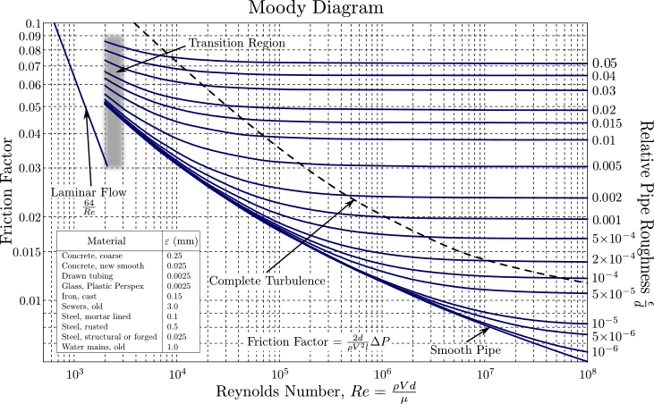

A few examples done by hand and with computational assistance. All four use water at 20 °C: $\rho = 998\ \text{kg/m}^3$, $\nu = 1.00\times10^{-6}\ \text{m}^2/\text{s}$. Loss coefficients come from [11.1b Minor loss coefficients](minor-loss-coefficients.qmd) and roughness values from the table in [11.1 Pipe losses](pipe-losses.qmd).


## Example 1: Given the flow rate, find the inlet pressure

We need to deliver $Q = 0.4$ L/s from a tap. Water begins at the pressure gauge (point 1), travels $L_1 = 10$ m horizontally, turns up through a threaded elbow, rises $L_2 = 4$ m, turns right through a second threaded elbow, and travels $L_3 = 3$ m through a fully open gate valve before leaving as a free jet (point 2). The pipe is drawn copper tubing ($\epsilon = 0.0025$ mm) with $D = 2$ cm the whole way. What gauge pressure $p_1$ does the supply need to provide?

```{=html}
<div style="display:flex; justify-content:center; margin: 1.5em 0;">
<svg width="660" height="310" style="max-width:100%; height:auto;" viewBox="0 0 660 310" xmlns="http://www.w3.org/2000/svg" font-family="sans-serif" role="img" aria-label="Single pipe of diameter D. Water at point 1, where a pressure gauge reads p1 (unknown), flows right through horizontal length L1, turns up at a 90 degree threaded elbow, rises through vertical length L2, turns right at a second threaded elbow, passes through a fully open gate valve in horizontal length L3, and leaves the open end as a free jet to the atmosphere at point 2. The flow rate Q is given.">
  <defs>
    <marker id="pe1-arrow-red" viewBox="0 0 10 10" refX="9" refY="5" markerWidth="6" markerHeight="6" orient="auto-start-reverse">
      <path d="M 0 0 L 10 5 L 0 10 z" fill="#e0311f"/>
    </marker>
    <marker id="pe1-arrow-blue" viewBox="0 0 10 10" refX="9" refY="5" markerWidth="6" markerHeight="6" orient="auto-start-reverse">
      <path d="M 0 0 L 10 5 L 0 10 z" fill="#1f77e0"/>
    </marker>
    <marker id="pe1-arrow-green" viewBox="0 0 10 10" refX="9" refY="5" markerWidth="5" markerHeight="5" orient="auto-start-reverse">
      <path d="M 0 0 L 10 5 L 0 10 z" fill="#1f8a3a"/>
    </marker>
    <marker id="pe1-arrow-purple" viewBox="0 0 10 10" refX="9" refY="5" markerWidth="5" markerHeight="5" orient="auto-start-reverse">
      <path d="M 0 0 L 10 5 L 0 10 z" fill="#8a3fd1"/>
    </marker>
    <marker id="pe1-arrow-black" viewBox="0 0 10 10" refX="9" refY="5" markerWidth="6" markerHeight="6" orient="auto-start-reverse">
      <path d="M 0 0 L 10 5 L 0 10 z" fill="#1a1a1a"/>
    </marker>
  </defs>

  <!-- opaque background so the diagram stays legible in dark mode too -->
  <rect x="0" y="0" width="660" height="310" fill="#ffffff"/>

  <!-- water in the pipe (centerline 40,240 -> 360,240 -> 360,80 -> 560,80) and the free jet -->
  <polygon points="40,231 351,231 351,71 560,71 560,89 369,89 369,249 40,249" fill="#a8e4f0"/>
  <path d="M 560 71 Q 615 72 636 130 L 618 130 Q 602 92 560 89 Z" fill="#a8e4f0"/>

  <!-- pipe walls -->
  <g stroke="#1a1a1a" stroke-width="2.5" fill="none" stroke-linejoin="miter">
    <path d="M 40 249 L 369 249 L 369 89 L 560 89"/>
    <path d="M 40 231 L 351 231 L 351 71 L 560 71"/>
  </g>
  <!-- break mark: the pipe continues upstream to the supply -->
  <path d="M 40 224 L 34 234 L 46 246 L 40 256" fill="none" stroke="#1a1a1a" stroke-width="1.5"/>
  <text x="50" y="278" font-size="13" fill="#1a1a1a">from supply</text>

  <!-- pressure gauge at point 1 -->
  <line x1="70" y1="231" x2="70" y2="207" stroke="#1a1a1a" stroke-width="2"/>
  <circle cx="70" cy="195" r="12" fill="#ffffff" stroke="#1a1a1a" stroke-width="2"/>
  <line x1="70" y1="195" x2="77" y2="188" stroke="#1a1a1a" stroke-width="1.5"/>
  <text x="90" y="200" font-size="16" fill="#8a3fd1"><tspan font-style="italic">p</tspan><tspan dy="4" font-size="11">1</tspan><tspan dy="-4">&#160;=&#160;?</tspan></text>

  <!-- gate valve on section 3 -->
  <g stroke="#1a1a1a" stroke-width="2" fill="#ffffff">
    <path d="M 446 66 L 460 80 L 446 94 Z"/>
    <path d="M 474 66 L 460 80 L 474 94 Z"/>
  </g>
  <g stroke="#1a1a1a" stroke-width="2">
    <line x1="460" y1="80" x2="460" y2="54"/>
    <line x1="451" y1="54" x2="469" y2="54"/>
  </g>

  <!-- flow direction and flow rate -->
  <line x1="130" y1="240" x2="165" y2="240" stroke="#1f77e0" stroke-width="2" marker-end="url(#pe1-arrow-blue)"/>
  <text x="148" y="222" font-size="16" fill="#1f77e0" text-anchor="middle"><tspan font-style="italic">Q</tspan><tspan>&#160;(given)</tspan></text>

  <!-- stations -->
  <circle cx="70" cy="240" r="4" fill="#1a1a1a"/>
  <circle cx="560" cy="80" r="4" fill="#1a1a1a"/>
  <text x="566" y="105" font-size="16" fill="#1a1a1a">2</text>
  <text x="640" y="152" font-size="13" fill="#1f77e0" text-anchor="end">free jet, <tspan font-style="italic">p</tspan><tspan dy="4" font-size="9">atm</tspan></text>

  <!-- lengths (red dimension lines, measured along the centerline) -->
  <g stroke="#e0311f" stroke-width="1.3" fill="none">
    <line x1="70" y1="290" x2="360" y2="290" marker-start="url(#pe1-arrow-red)" marker-end="url(#pe1-arrow-red)"/>
    <line x1="400" y1="80" x2="400" y2="240" marker-start="url(#pe1-arrow-red)" marker-end="url(#pe1-arrow-red)"/>
    <line x1="360" y1="30" x2="560" y2="30" marker-start="url(#pe1-arrow-red)" marker-end="url(#pe1-arrow-red)"/>
    <!-- extension lines -->
    <line x1="70" y1="255" x2="70" y2="296" stroke-dasharray="2 2"/>
    <line x1="360" y1="255" x2="360" y2="296" stroke-dasharray="2 2"/>
    <line x1="375" y1="240" x2="406" y2="240" stroke-dasharray="2 2"/>
    <line x1="360" y1="24" x2="360" y2="66" stroke-dasharray="2 2"/>
    <line x1="560" y1="24" x2="560" y2="66" stroke-dasharray="2 2"/>
  </g>
  <g fill="#e0311f" font-size="16">
    <text x="215" y="285" text-anchor="middle"><tspan font-style="italic">L</tspan><tspan dy="4" font-size="11">1</tspan></text>
    <text x="406" y="165"><tspan font-style="italic">L</tspan><tspan dy="4" font-size="11">2</tspan></text>
    <text x="460" y="22" text-anchor="middle"><tspan font-style="italic">L</tspan><tspan dy="4" font-size="11">3</tspan></text>
  </g>

  <!-- diameter -->
  <g stroke="#e0311f" stroke-width="1.3">
    <line x1="230" y1="210" x2="230" y2="229" marker-end="url(#pe1-arrow-red)"/>
    <line x1="230" y1="270" x2="230" y2="251" marker-end="url(#pe1-arrow-red)"/>
  </g>
  <text x="236" y="214" font-size="16" fill="#e0311f"><tspan font-style="italic">D</tspan></text>

  <!-- minor loss elements -->
  <g stroke="#1f8a3a" stroke-width="1.2">
    <line x1="420" y1="262" x2="372" y2="251" marker-end="url(#pe1-arrow-green)"/>
    <line x1="300" y1="52" x2="348" y2="68" marker-end="url(#pe1-arrow-green)"/>
    <line x1="460" y1="122" x2="460" y2="97" marker-end="url(#pe1-arrow-green)"/>
  </g>
  <g fill="#1f8a3a" font-size="13">
    <text x="424" y="268">90° threaded elbow</text>
    <text x="296" y="52" text-anchor="end">90° threaded elbow</text>
    <text x="460" y="136" text-anchor="middle">gate valve (fully open)</text>
  </g>

  <!-- gravity -->
  <line x1="620" y1="200" x2="620" y2="255" stroke="#1a1a1a" stroke-width="2" marker-end="url(#pe1-arrow-black)"/>
  <text x="630" y="234" font-size="17" font-style="italic" fill="#1a1a1a">g</text>
</svg>
</div>
```

::: {.callout-note collapse="true"}
## Solution by hand

Start with the full head equation with **three sections of pipe** and **three minor losses**:

$$
\begin{align*}
\left[\frac{1}{2g}\alpha_1 U_1^2 + z_1 + \frac{p_1}{\rho g}\right] = \left[\frac{1}{2g}\alpha_2 U_2^2 + z_2 + \frac{p_2}{\rho g}\right] &+ \frac{U_1^2}{2g}\frac{f_1L_1}{D} + \frac{U_2^2}{2g}\frac{f_2L_2}{D} + \frac{U_3^2}{2g}\frac{f_3L_3}{D} \\
&+ \frac{U^2}{2g}K_\text{L,elbow} + \frac{U^2}{2g}K_\text{L,elbow} + \frac{U^2}{2g}K_\text{L,valve}.
\end{align*}
$$

We assume $z_\text{1}=0$ and $p_2=0$ (gauge), and $z_2=L_2=4\text{ m}$. We also note that, since the three sections of pipe are all the same diameter, they'll have the same $\text{Re}$, same $\epsilon/D=0.0025\text{ mm}/20\text{ mm}=1.25\times10^{-4}$, same $f$, and so we can combine the major loss terms into one term with total length $L_1+L_2+L_3$. After rearranging to solve for $p_1$, we have

$$
p_1 = \rho g L_2 + \tfrac{1}{2}\rho U^2\left[\left(\alpha_2-\alpha_1\right) + \frac{f\left(L_1+L_2+L_3\right)}{D} + 2K_\text{L,elbow} + K_\text{L,valve}\right].
$$

Calculate the Reynolds Number

$$
\begin{align*}
U &= \frac{Q}{\frac{\pi}{4}D^2} = \frac{0.4\times10^{-3}\ \text{m}^3/\text{s}}{\frac{\pi}{4}\left(0.02\ \text{m}\right)^2} = 1.27\ \text{m/s} \\
\text{Re}_D &= \frac{\rho U D}{\mu} = \frac{UD}{\nu} = \frac{\left(1.27\ \text{m/s}\right)\left(0.02\ \text{m}\right)}{1.00\times10^{-6}\ \text{m}^2/\text{s}} = 2.5\times10^{4}.
\end{align*}
$$

Note that, since $\text{Re}_D>2300$, the flow is turbulent and $\alpha_1=\alpha_2\approx 1$.

For this example, let's use a Moody Diagram: the $\text{Re}=2.5\times10^{4}$, $\epsilon/D=1.25\times10^{-4}$ point falls here on the diagram

```{=html}
<div style="position:relative; background:#fff; padding:4px; margin:1em 0;">
  <div style="position:relative;">
    
    <svg viewBox="0 0 731.96065 452.90348" style="position:absolute; left:0; top:0; width:100%; height:100%;" xmlns="http://www.w3.org/2000/svg" font-family="sans-serif" aria-hidden="true">
      <g stroke="#e0311f" fill="none">
        <line x1="244.5" y1="405.7" x2="244.5" y2="214.5" stroke-width="1.3" stroke-dasharray="4 3"/>
        <line x1="48.3" y1="214.5" x2="244.5" y2="214.5" stroke-width="1.3" stroke-dasharray="4 3"/>
        <circle cx="244.5" cy="214.5" r="4.5" stroke-width="1.8"/>
      </g>
      <rect x="254" y="184" width="150" height="19" rx="3" fill="#ffffff" stroke="#e0311f" stroke-width="0.8"/>
      <text x="329" y="197.5" font-size="11.5" fill="#e0311f" text-anchor="middle">Re = 2.5×10⁴ → <tspan font-style="italic">f</tspan> ≈ 0.025</text>
    </svg>
  </div>
</div>
```

and so we see $f=0.025$. We also look up the minor loss coefficients: for a 90° threaded elbow, $K_\text{L}=1.5$, and for a fully open gate valve $K_\text{L}=0.15$. Plugging all this information into the head equation, we find

$$
\begin{align*}
p_1 &= \left(998\ \tfrac{\text{kg}}{\text{m}^3}\right)\left(9.81\ \tfrac{\text{m}}{\text{s}^2}\right)\left(4\ \text{m}\right) + \tfrac{1}{2}\left(998\ \tfrac{\text{kg}}{\text{m}^3}\right)\left(1.27\ \tfrac{\text{m}}{\text{s}}\right)^2\left[0 + \frac{0.025\left(17\ \text{m}\right)}{0.02\ \text{m}} + 2\left(1.5\right) + 0.15\right] \\
&= 39.2\ \text{kPa} + \left(0.81\ \text{kPa}\right)\left[21.3 + 3.15\right] \\
&= 58.9\ \text{kPa (gauge)}.
\end{align*}
$$

:::


## Example 2: Determining flow rate from a water tower

This one we basically covered in class... let's put some numbers to it.

Water leaves an elevated tank through a sharp-edged entrance in its floor. The free surface sits $h = 5$ m above the tank floor, and it's wide enough that $U \approx 0$ there. The pipe drops $L_1 = 20$ m, turns right and runs $L_2 = 30$ m, turns down for a short $L_3 = 3$ m, then turns right again for $L_4 = 15$ m and discharges as a free jet. All three elbows are flanged; the pipe is structural steel ($\epsilon = 0.025$ mm) with $D = 5$ cm. What flow rate does the tank supply?

```{=html}
<div style="display:flex; justify-content:center; margin: 1.5em 0;">
<svg width="660" height="400" style="max-width:100%; height:auto;" viewBox="0 0 660 400" xmlns="http://www.w3.org/2000/svg" font-family="sans-serif" role="img" aria-label="Elevated tank with free surface at height h above its floor, where U is approximately zero and the pressure is atmospheric. A pipe of diameter D leaves the tank floor through a sharp-edged entrance and drops vertically through length L1, turns right at a flanged elbow into horizontal length L2, turns down at a second flanged elbow for a short vertical length L3, turns right at a third flanged elbow into horizontal length L4, and leaves as a free jet to the atmosphere. The flow rate Q is unknown.">
  <defs>
    <marker id="pe2-arrow-red" viewBox="0 0 10 10" refX="9" refY="5" markerWidth="6" markerHeight="6" orient="auto-start-reverse">
      <path d="M 0 0 L 10 5 L 0 10 z" fill="#e0311f"/>
    </marker>
    <marker id="pe2-arrow-blue" viewBox="0 0 10 10" refX="9" refY="5" markerWidth="6" markerHeight="6" orient="auto-start-reverse">
      <path d="M 0 0 L 10 5 L 0 10 z" fill="#1f77e0"/>
    </marker>
    <marker id="pe2-arrow-green" viewBox="0 0 10 10" refX="9" refY="5" markerWidth="5" markerHeight="5" orient="auto-start-reverse">
      <path d="M 0 0 L 10 5 L 0 10 z" fill="#1f8a3a"/>
    </marker>
    <marker id="pe2-arrow-black" viewBox="0 0 10 10" refX="9" refY="5" markerWidth="6" markerHeight="6" orient="auto-start-reverse">
      <path d="M 0 0 L 10 5 L 0 10 z" fill="#1a1a1a"/>
    </marker>
  </defs>

  <!-- opaque background so the diagram stays legible in dark mode too -->
  <rect x="0" y="0" width="660" height="400" fill="#ffffff"/>

  <!-- tank -->
  <rect x="40" y="40" width="120" height="80" fill="#a8e4f0"/>
  <g stroke="#1a1a1a" stroke-width="2.5" fill="none">
    <path d="M 40 15 L 40 120 L 89 120"/>
    <path d="M 111 120 L 160 120 L 160 15"/>
  </g>
  <line x1="40" y1="40" x2="160" y2="40" stroke="#1f77e0" stroke-width="1.5"/>
  <path d="M 93 28 L 107 28 L 100 38 Z" fill="none" stroke="#1f77e0" stroke-width="1.3"/>
  <text x="70" y="34" font-size="16" fill="#1a1a1a" text-anchor="middle">1</text>
  <text x="170" y="38" font-size="13" fill="#1f77e0"><tspan font-style="italic">U</tspan> ≈ 0, <tspan font-style="italic">p</tspan><tspan dy="4" font-size="9">atm</tspan></text>

  <!-- water in the pipe (centerline 100,120 -> 100,260 -> 380,260 -> 380,320 -> 580,320) and the free jet -->
  <polygon points="89,120 111,120 111,249 391,249 391,309 580,309 580,331 369,331 369,271 89,271" fill="#a8e4f0"/>
  <path d="M 580 309 Q 628 310 645 365 L 627 365 Q 614 333 580 331 Z" fill="#a8e4f0"/>

  <!-- pipe walls -->
  <g stroke="#1a1a1a" stroke-width="2.5" fill="none" stroke-linejoin="miter">
    <path d="M 89 120 L 89 271 L 369 271 L 369 331 L 580 331"/>
    <path d="M 111 120 L 111 249 L 391 249 L 391 309 L 580 309"/>
  </g>

  <!-- flow direction -->
  <line x1="100" y1="150" x2="100" y2="185" stroke="#1f77e0" stroke-width="2" marker-end="url(#pe2-arrow-blue)"/>
  <line x1="450" y1="320" x2="490" y2="320" stroke="#1f77e0" stroke-width="2" marker-end="url(#pe2-arrow-blue)"/>
  <text x="470" y="300" font-size="16" fill="#1f77e0" text-anchor="middle"><tspan font-style="italic">Q</tspan><tspan>&#160;=&#160;?</tspan></text>

  <!-- exit station -->
  <circle cx="580" cy="320" r="4" fill="#1a1a1a"/>
  <text x="575" y="303" font-size="16" fill="#1a1a1a" text-anchor="end">2</text>
  <text x="655" y="388" font-size="13" fill="#1f77e0" text-anchor="end">free jet, <tspan font-style="italic">p</tspan><tspan dy="4" font-size="9">atm</tspan></text>

  <!-- lengths (red dimension lines) -->
  <g stroke="#e0311f" stroke-width="1.3" fill="none">
    <line x1="25" y1="40" x2="25" y2="120" marker-start="url(#pe2-arrow-red)" marker-end="url(#pe2-arrow-red)"/>
    <line x1="60" y1="120" x2="60" y2="260" marker-start="url(#pe2-arrow-red)" marker-end="url(#pe2-arrow-red)"/>
    <line x1="100" y1="215" x2="380" y2="215" marker-start="url(#pe2-arrow-red)" marker-end="url(#pe2-arrow-red)"/>
    <line x1="420" y1="260" x2="420" y2="320" marker-start="url(#pe2-arrow-red)" marker-end="url(#pe2-arrow-red)"/>
    <line x1="380" y1="370" x2="580" y2="370" marker-start="url(#pe2-arrow-red)" marker-end="url(#pe2-arrow-red)"/>
    <!-- extension lines -->
    <line x1="19" y1="40" x2="38" y2="40" stroke-dasharray="2 2"/>
    <line x1="19" y1="120" x2="38" y2="120" stroke-dasharray="2 2"/>
    <line x1="54" y1="260" x2="83" y2="260" stroke-dasharray="2 2"/>
    <line x1="380" y1="209" x2="380" y2="243" stroke-dasharray="2 2"/>
    <line x1="397" y1="260" x2="426" y2="260" stroke-dasharray="2 2"/>
    <line x1="380" y1="337" x2="380" y2="376" stroke-dasharray="2 2"/>
    <line x1="580" y1="337" x2="580" y2="376" stroke-dasharray="2 2"/>
  </g>
  <g fill="#e0311f" font-size="16">
    <text x="18" y="86" text-anchor="end"><tspan font-style="italic">h</tspan></text>
    <text x="53" y="195" text-anchor="end"><tspan font-style="italic">L</tspan><tspan dy="4" font-size="11">1</tspan></text>
    <text x="240" y="207" text-anchor="middle"><tspan font-style="italic">L</tspan><tspan dy="4" font-size="11">2</tspan></text>
    <text x="428" y="295"><tspan font-style="italic">L</tspan><tspan dy="4" font-size="11">3</tspan></text>
    <text x="480" y="390" text-anchor="middle"><tspan font-style="italic">L</tspan><tspan dy="4" font-size="11">4</tspan></text>
  </g>

  <!-- diameter -->
  <g stroke="#e0311f" stroke-width="1.3">
    <line x1="250" y1="228" x2="250" y2="247" marker-end="url(#pe2-arrow-red)"/>
    <line x1="250" y1="292" x2="250" y2="273" marker-end="url(#pe2-arrow-red)"/>
  </g>
  <text x="256" y="298" font-size="16" fill="#e0311f"><tspan font-style="italic">D</tspan></text>

  <!-- minor loss elements -->
  <g stroke="#1f8a3a" stroke-width="1.2">
    <line x1="122" y1="136" x2="113" y2="123" marker-end="url(#pe2-arrow-green)"/>
    <line x1="122" y1="296" x2="92" y2="274" marker-end="url(#pe2-arrow-green)"/>
    <line x1="420" y1="236" x2="394" y2="247" marker-end="url(#pe2-arrow-green)"/>
    <line x1="330" y1="348" x2="366" y2="334" marker-end="url(#pe2-arrow-green)"/>
  </g>
  <g fill="#1f8a3a" font-size="13">
    <text x="125" y="148">sharp-edged entrance</text>
    <text x="125" y="306">flanged 90° elbow</text>
    <text x="424" y="238">flanged elbow</text>
    <text x="326" y="356" text-anchor="end">flanged elbow</text>
  </g>

  <!-- gravity -->
  <line x1="610" y1="90" x2="610" y2="145" stroke="#1a1a1a" stroke-width="2" marker-end="url(#pe2-arrow-black)"/>
  <text x="620" y="124" font-size="17" font-style="italic" fill="#1a1a1a">g</text>
</svg>
</div>
```

::: {.callout-note collapse="true"}
## Solution by hand

We again start with the head equation. Let's immediately recognize that the pipe diameter is the same everywhere, and so we can write **one cumulative major loss term** with total length $L_1+L_2+L_3+L_4$ and **one cumulative minor loss term** with total minor loss coefficient $K_\text{L,sharp}+3K_\text{L,elbow}$. Thus, our head equation is

$$
\left[\frac{1}{2g}\alpha_1 U_1^2 + z_1 + \frac{p_1}{\rho g}\right] = \left[\frac{1}{2g}\alpha_2 U_2^2 + z_2 + \frac{p_2}{\rho g}\right] + \frac{U_2^2}{2g}\left[\frac{f\left(L_1+L_2+L_3+L_4\right)}{D} + K_\text{L,sharp}+3K_\text{L,elbow}\right].
$$

We assume $U_1=0$, $z_2=0$, and $p_1=p_2=0$. We'll further assume that the flow at the exit is turbulent such that $\alpha_2=1$. We recognize $z_1=h+L_1+L_3$, and we look up the loss coefficients for a sharp-edged entrance ($K_\text{L}=0.5$) and a flanged 90° elbow ($K_\text{L}=0.3$). The head equation therefore becomes

$$
\begin{align*}
0 &= \left(h+L_1+L_3\right) - \frac{U_2^2}{2g}\left[\alpha_2 + \frac{f\left(L_1+L_2+L_3+L_4\right)}{D} + K_\text{L,sharp}+3K_\text{L,elbow}\right] \\
&= 28\ \text{m} - \frac{U_2^2}{2g}\left[1 + f\,\frac{68\ \text{m}}{0.05\ \text{m}} + 0.5 + 3\left(0.3\right)\right].
\end{align*}
$$


::: {.callout-important}

Note that $f$ depends on $U$ in a complicated way... it is impossible to solve this equation explicitly! Instead, we'll use an iterative method... AKA guess and check.

:::

I'll build a table below of our guesses and the ensuing calculations, including the value of the right-hand side of the head equation (remember, our goal is to get it to $0$). Let's start by guessing $U_2=1\text{ m/s}$. (We also need $\epsilon=0.025\text{ mm}$ and so $\epsilon/D=0.025/50=5\times10^{-4}$ in the calculations below, but that is a constant.) We'll use [Wolfram Alpha to calculate the friction factor](https://www.wolframalpha.com/input?i=colebrook+equation&assumption=%7B%22FS%22%7D+-%3E+%7B%7B%22ColebrookWhiteEquation%22%2C+%22lambda%22%7D%2C+%7B%22ColebrookWhiteEquation%22%2C+%22Re%22%7D%2C+%7B%22ColebrookWhiteEquation%22%2C+%22K%22%7D%7D&assumption=%7B%22F%22%2C+%22ColebrookWhiteEquation%22%2C+%22K%22%7D+-%3E%220.1%22&assumption=%7B%22F%22%2C+%22ColebrookWhiteEquation%22%2C+%22Re%22%7D+-%3E%225000%22).

| $U_2$ (m/s) | $\text{Re}_D$ | $f$ | RHS (m) |
|:-----:|:-----:|:-----:|:-----:|
| 1.0 | $5.0\times10^4$ | 0.0226 | +26.3 |
| 3.0 | $1.5\times10^5$ | 0.0194 | +14.8 |
| 5.0 | $2.5\times10^5$ | 0.0185 | −7.05 |
| 4.0 | $2.0\times10^5$ | 0.0188 | +5.17 |
| 4.5 | $2.25\times10^5$ | 0.0186 | −0.62 |
| 4.45 | $2.2\times10^5$ | 0.0186 | −0.01 |

Thus, we find that our head equation is solved by $U_2=4.45\text{ m/s}$, meaning

$$
Q=\frac{\pi D^2}{4}U_2 = \frac{\pi \left(0.05\ \text{m}\right)^2}{4}\left(4.45\ \text{m/s}\right) = 8.7\times10^{-3}\ \text{m}^3/\text{s} = 8.7\ \text{L/s}.
$$


::: {.callout-note}

One thing we should probably check: with $U_2=4.45\text{ m/s}$, the Reynolds Number is $\text{Re}_D = U_2D/\nu = 2.2\times10^5$. This indicates turbulent flow, and so our assumption that $\alpha_2=1$ is confirmed.

:::

:::


## Example 3: Parallel paths

A cast iron line ($\epsilon = 0.15$ mm) carries $Q_\text{total} = 10$ L/s. At point 1 it splits at a threaded tee: path A continues straight through (20 m long, with a fully open gate valve), and path B turns the corner, drops down, runs across, and comes back up to rejoin at a second tee at point 2 (50 m along its centerline, with two threaded elbows). Every pipe has $D = 5$ cm. How does the flow split between the two paths, and what is the pressure drop from 1 to 2?

```{=html}
<div style="display:flex; justify-content:center; margin: 1.5em 0;">
<svg width="660" height="345" style="max-width:100%; height:auto;" viewBox="0 0 660 345" xmlns="http://www.w3.org/2000/svg" font-family="sans-serif" role="img" aria-label="Two parallel pipe paths of equal diameter D. A pipe carrying Q total reaches a tee at point 1. Path A continues straight through the tee and runs horizontally through length L A, passing a fully open gate valve, to a second tee at point 2. Path B turns the corner at the first tee, drops down, turns at a threaded elbow, runs horizontally, turns up at a second threaded elbow, and rejoins at the second tee; its length L B is measured along the whole path. The flows Q A and Q B are unknown. The head loss from 1 to 2 is the same along either path.">
  <defs>
    <marker id="pe3-arrow-red" viewBox="0 0 10 10" refX="9" refY="5" markerWidth="6" markerHeight="6" orient="auto-start-reverse">
      <path d="M 0 0 L 10 5 L 0 10 z" fill="#e0311f"/>
    </marker>
    <marker id="pe3-arrow-blue" viewBox="0 0 10 10" refX="9" refY="5" markerWidth="6" markerHeight="6" orient="auto-start-reverse">
      <path d="M 0 0 L 10 5 L 0 10 z" fill="#1f77e0"/>
    </marker>
    <marker id="pe3-arrow-green" viewBox="0 0 10 10" refX="9" refY="5" markerWidth="5" markerHeight="5" orient="auto-start-reverse">
      <path d="M 0 0 L 10 5 L 0 10 z" fill="#1f8a3a"/>
    </marker>
    <marker id="pe3-arrow-purple" viewBox="0 0 10 10" refX="9" refY="5" markerWidth="5" markerHeight="5" orient="auto-start-reverse">
      <path d="M 0 0 L 10 5 L 0 10 z" fill="#8a3fd1"/>
    </marker>
  </defs>

  <!-- opaque background so the diagram stays legible in dark mode too -->
  <rect x="0" y="0" width="660" height="345" fill="#ffffff"/>

  <!-- pipe network, drawn twice: wide dark strokes make the walls, narrower water strokes open up the junctions -->
  <g fill="none" stroke="#1a1a1a" stroke-linejoin="miter">
    <path d="M 20 120 L 640 120" stroke-width="27"/>
    <path d="M 170 120 L 170 270 L 490 270 L 490 120" stroke-width="27"/>
  </g>
  <g fill="none" stroke="#a8e4f0" stroke-linejoin="miter">
    <path d="M 20 120 L 640 120" stroke-width="22"/>
    <path d="M 170 120 L 170 270 L 490 270 L 490 120" stroke-width="22"/>
  </g>

  <!-- gate valve on path A -->
  <g stroke="#1a1a1a" stroke-width="2" fill="#ffffff">
    <path d="M 315 103 L 330 120 L 315 137 Z"/>
    <path d="M 345 103 L 330 120 L 345 137 Z"/>
  </g>
  <g stroke="#1a1a1a" stroke-width="2">
    <line x1="330" y1="120" x2="330" y2="93"/>
    <line x1="321" y1="93" x2="339" y2="93"/>
  </g>

  <!-- flow direction and flow rates -->
  <g stroke="#1f77e0" stroke-width="2">
    <line x1="55" y1="120" x2="95" y2="120" marker-end="url(#pe3-arrow-blue)"/>
    <line x1="395" y1="120" x2="430" y2="120" marker-end="url(#pe3-arrow-blue)"/>
    <line x1="395" y1="270" x2="430" y2="270" marker-end="url(#pe3-arrow-blue)"/>
    <line x1="560" y1="120" x2="600" y2="120" marker-end="url(#pe3-arrow-blue)"/>
  </g>
  <g fill="#1f77e0" font-size="16" text-anchor="middle">
    <text x="75" y="98"><tspan font-style="italic">Q</tspan><tspan dy="4" font-size="11">total</tspan></text>
    <text x="412" y="98"><tspan font-style="italic">Q</tspan><tspan dy="4" font-size="11">A</tspan><tspan dy="-4">&#160;=&#160;?</tspan></text>
    <text x="412" y="248"><tspan font-style="italic">Q</tspan><tspan dy="4" font-size="11">B</tspan><tspan dy="-4">&#160;=&#160;?</tspan></text>
    <text x="580" y="98"><tspan font-style="italic">Q</tspan><tspan dy="4" font-size="11">total</tspan></text>
  </g>

  <!-- the two junctions -->
  <circle cx="170" cy="120" r="4" fill="#1a1a1a"/>
  <circle cx="490" cy="120" r="4" fill="#1a1a1a"/>
  <g fill="#1a1a1a" font-size="16">
    <text x="160" y="100" text-anchor="end"><tspan font-style="italic">p</tspan><tspan dy="4" font-size="11">1</tspan></text>
    <text x="500" y="100"><tspan font-style="italic">p</tspan><tspan dy="4" font-size="11">2</tspan></text>
  </g>
  <g fill="#1a1a1a" font-size="14" text-anchor="middle">
    <text x="255" y="160">path A</text>
    <text x="255" y="255">path B</text>
  </g>
  <line x1="220" y1="215" x2="440" y2="215" stroke="#8a3fd1" stroke-width="1.2" marker-end="url(#pe3-arrow-purple)"/>
  <text x="330" y="207" font-size="13" fill="#8a3fd1" text-anchor="middle">same head loss from 1 to 2 along A or B</text>

  <!-- lengths -->
  <g stroke="#e0311f" stroke-width="1.3" fill="none">
    <line x1="170" y1="40" x2="490" y2="40" marker-start="url(#pe3-arrow-red)" marker-end="url(#pe3-arrow-red)"/>
    <line x1="170" y1="34" x2="170" y2="100" stroke-dasharray="2 2"/>
    <line x1="490" y1="34" x2="490" y2="100" stroke-dasharray="2 2"/>
    <!-- L_B follows the whole path -->
    <path d="M 140 142 L 140 300 L 520 300 L 520 142" stroke-dasharray="5 3" marker-start="url(#pe3-arrow-red)" marker-end="url(#pe3-arrow-red)"/>
  </g>
  <g fill="#e0311f" font-size="16" text-anchor="middle">
    <text x="250" y="32"><tspan font-style="italic">L</tspan><tspan dy="4" font-size="11">A</tspan></text>
    <text x="330" y="322"><tspan font-style="italic">L</tspan><tspan dy="4" font-size="11">B</tspan><tspan dy="-4" font-size="13">&#160;(along the whole path)</tspan></text>
  </g>

  <!-- diameter -->
  <g stroke="#e0311f" stroke-width="1.3">
    <line x1="122" y1="152" x2="122" y2="133" marker-end="url(#pe3-arrow-red)"/>
    <line x1="122" y1="88" x2="122" y2="107" marker-end="url(#pe3-arrow-red)"/>
  </g>
  <text x="116" y="166" font-size="16" fill="#e0311f" text-anchor="end"><tspan font-style="italic">D</tspan><tspan font-size="13">&#160;(all pipes)</tspan></text>

  <!-- minor loss elements -->
  <g stroke="#1f8a3a" stroke-width="1.2">
    <line x1="330" y1="166" x2="330" y2="141" marker-end="url(#pe3-arrow-green)"/>
    <line x1="210" y1="178" x2="184" y2="138" marker-end="url(#pe3-arrow-green)"/>
    <line x1="450" y1="178" x2="476" y2="138" marker-end="url(#pe3-arrow-green)"/>
    <line x1="112" y1="300" x2="156" y2="284" marker-end="url(#pe3-arrow-green)"/>
    <line x1="548" y1="300" x2="504" y2="284" marker-end="url(#pe3-arrow-green)"/>
  </g>
  <g fill="#1f8a3a" font-size="13">
    <text x="330" y="180" text-anchor="middle">gate valve (open)</text>
    <text x="212" y="192">tee</text>
    <text x="448" y="192" text-anchor="end">tee</text>
    <text x="108" y="314" text-anchor="end">elbow</text>
    <text x="552" y="314">elbow</text>
  </g>
</svg>
</div>
```


::: {.callout-note collapse="true"}
## Solution by hand

We start by recognizing the head loss through path "A" must match the head loss through path "B":


$$
H_\text{A} &= H_\text{B}
$$

where

$$
H_\text{A} = \frac{U_\text{A}^2}{2g}\left[\frac{f_\text{A}L_\text{A}}{D} + K_\text{L,tee,line} + K_\text{L,gate} + K_\text{L,tee,line}\right] = \frac{U_\text{A}^2}{2g}\left[f_\text{A}\,\frac{20\ \text{m}}{0.05\ \text{m}} + 0.9 + 0.15 + 0.9\right]
$$

and

$$
H_\text{B} = \frac{U_\text{B}^2}{2g}\left[\frac{f_\text{B}L_\text{B}}{D} + 2K_\text{L,tee,branch} + 2K_\text{L,elbow}\right] = \frac{U_\text{B}^2}{2g}\left[f_\text{B}\,\frac{50\ \text{m}}{0.05\ \text{m}} + 2\left(2.0\right) + 2\left(1.5\right)\right].
$$

Here we've looked up the loss coefficients for a threaded tee with line flow ($K_\text{L}=0.9$), a threaded tee with branch flow ($K_\text{L}=2.0$), a threaded 90° elbow ($K_\text{L}=1.5$), and a fully open gate valve ($K_\text{L}=0.15$). Path A goes straight through both tees, and path B turns the corner at both.

We additionally have, from conservation of mass

$$
Q_\text{total}= Q_\text{A}+Q_\text{B}.
$$

The last ingredient is one head equation:

$$
\begin{align*}
\left[\frac{1}{2g}\alpha_1 U_1^2 + z_1 + \frac{p_1}{\rho g}\right] &= \left[\frac{1}{2g}\alpha_2 U_2^2 + z_2 + \frac{p_2}{\rho g}\right] + H_\text{A} \\
\frac{p_1-p_2}{\rho g} &= H_\text{A},
\end{align*}
$$

since the speed at the two tees is the same ($Q_\text{total}$ and $D$ are the same at 1 and 2) and the two tees sit at the same height.

::: {.column-margin}
We could write it in terms of path "B" instead, it's equivalent.
:::


::: {.callout-important}

Again, the friction factors depend on speed, and so the equations are impossible to solve explicitly. Again, we iterate... and in this case we guess-and-check velocities for one of the paths (let's say "A") until we satisfy all our equations: that $H_\text{A}=H_\text{B}$, that $Q_\text{total}=Q_\text{A}+Q_\text{B}$.

:::

Let's again build a table of results, starting with $U_\text{A}=1\text{ m/s}$. We'll calculate the left-hand side and right-hand side of $H_\text{A}=H_\text{B}$ separately, and iterate until they are approximately equal. We look up $\epsilon=0.15\text{ mm}$ and so $\epsilon/D=0.15/50=3\times10^{-3}$ for all cases below. This time we'll use a numerical technique to determine the friction factor (details in the note below).

| $U_\text{A}$ (m/s) | $Q_\text{A}$ (L/s) | $Q_\text{B}$ (L/s) | $U_\text{B}$ (m/s) | $\text{Re}_\text{A}$ | $\text{Re}_\text{B}$ | $f_\text{A}$ | $f_\text{B}$ | $H_\text{A}$ (m) | $H_\text{B}$ (m) |
|:---:|:---:|:---:|:---:|:---:|:---:|:---:|:---:|:---:|:---:|
| 1.0 | 1.96 | 8.04 | 4.09 | $5.0\times10^4$ | $2.0\times10^5$ | 0.0286 | 0.0268 | 0.68 | 28.9 |
| 3.0 | 5.89 | 4.11 | 2.09 | $1.5\times10^5$ | $1.0\times10^5$ | 0.0271 | 0.0274 | 5.86 | 7.68 |
| 3.5 | 6.87 | 3.13 | 1.59 | $1.75\times10^5$ | $8.0\times10^4$ | 0.0269 | 0.0278 | 7.94 | 4.50 |
| 3.2 | 6.28 | 3.72 | 1.89 | $1.6\times10^5$ | $9.5\times10^4$ | 0.0270 | 0.0275 | 6.66 | 6.31 |
| 3.17 | 6.22 | 3.78 | 1.92 | $1.6\times10^5$ | $9.6\times10^4$ | 0.0270 | 0.0275 | 6.53 | 6.51 |

That is, we find

$$
\begin{align*}
U_\text{A} &= 3.17\ \text{m/s}, & Q_\text{A} &= 6.2\ \text{L/s}, & Q_\text{B} &= 3.8\ \text{L/s}, \\
p_1 - p_2 &= \rho g H_\text{A} = \left(998\ \tfrac{\text{kg}}{\text{m}^3}\right)\left(9.81\ \tfrac{\text{m}}{\text{s}^2}\right)\left(6.5\ \text{m}\right) = 64\ \text{kPa}.
\end{align*}
$$

:::


::: {.callout-note collapse="true"}
## Computing the friction factor numerically

The Colebrook Equation

$$
\frac{1}{\sqrt{f}} = -2\log_{10}\left(\frac{\epsilon/D}{3.7} + \frac{2.51}{\text{Re}_D\sqrt{f}}\right)
$$

... has $f$ on both sides, so we can't solve for $f$ explicitly. We, as humans, can guess and check. We can also use numerical algorithms to determine it, e.g. here is some Python code to solve using the "fixed-point iteration method". 

```python
from math import log10, sqrt, pi

def colebrook(Re, rel_rough, f=0.03, tol=1e-10):
    """Solve 1/sqrt(f) = -2 log10( (eps/D)/3.7 + 2.51/(Re sqrt(f)) ) for f."""
    while True:
        f_new = (-2 * log10(rel_rough / 3.7 + 2.51 / (Re * sqrt(f)))) ** -2
        if abs(f_new - f) < tol:
            return f_new
        f = f_new

print(colebrook(1.5e5, 0.003))
```

:::


## Example 4: A pump curve

Now we pump water from a lower reservoir to an upper one whose free surface sits $\Delta z = 12$ m higher. Water leaves the lower tank through a sharp-edged entrance, passes through the pump, turns up through a flanged elbow, rises, turns right through a second flanged elbow, passes a fully open gate valve, and exits into the upper tank. The pipe is cast iron ($\epsilon = 0.15$ mm), $D = 10$ cm, with a total length $L_1 + L_2 + L_3 = 150$ m. The pump is the same generic one from the demo in [11.2](parallel-flow.qmd#demo):

$$
H_\text{pump} = 30\ \text{m}\left[1 - \left(\frac{Q}{25\ \text{L/s}}\right)^2\right].
$$

What flow rate does the system deliver, and how much head does the pump add?

```{=html}
<div style="display:flex; justify-content:center; margin: 1.5em 0;">
<svg width="660" height="370" style="max-width:100%; height:auto;" viewBox="0 0 660 370" xmlns="http://www.w3.org/2000/svg" font-family="sans-serif" role="img" aria-label="Pumping between two reservoirs. Water leaves a lower tank through a sharp-edged entrance into horizontal pipe length L1, which contains a pump, turns up at a flanged elbow into vertical length L2, turns right at a second flanged elbow into horizontal length L3, which contains a fully open gate valve, and exits into an upper tank below its free surface. The upper free surface is delta z above the lower free surface. The pipe diameter is D and the flow rate Q is unknown.">
  <defs>
    <marker id="pe4-arrow-red" viewBox="0 0 10 10" refX="9" refY="5" markerWidth="6" markerHeight="6" orient="auto-start-reverse">
      <path d="M 0 0 L 10 5 L 0 10 z" fill="#e0311f"/>
    </marker>
    <marker id="pe4-arrow-blue" viewBox="0 0 10 10" refX="9" refY="5" markerWidth="6" markerHeight="6" orient="auto-start-reverse">
      <path d="M 0 0 L 10 5 L 0 10 z" fill="#1f77e0"/>
    </marker>
    <marker id="pe4-arrow-green" viewBox="0 0 10 10" refX="9" refY="5" markerWidth="5" markerHeight="5" orient="auto-start-reverse">
      <path d="M 0 0 L 10 5 L 0 10 z" fill="#1f8a3a"/>
    </marker>
    <marker id="pe4-arrow-purple" viewBox="0 0 10 10" refX="9" refY="5" markerWidth="5" markerHeight="5" orient="auto-start-reverse">
      <path d="M 0 0 L 10 5 L 0 10 z" fill="#8a3fd1"/>
    </marker>
    <marker id="pe4-arrow-black" viewBox="0 0 10 10" refX="9" refY="5" markerWidth="6" markerHeight="6" orient="auto-start-reverse">
      <path d="M 0 0 L 10 5 L 0 10 z" fill="#1a1a1a"/>
    </marker>
  </defs>

  <!-- opaque background so the diagram stays legible in dark mode too -->
  <rect x="0" y="0" width="660" height="370" fill="#ffffff"/>

  <!-- lower tank -->
  <rect x="20" y="250" width="110" height="80" fill="#a8e4f0"/>
  <g stroke="#1a1a1a" stroke-width="2.5" fill="none">
    <path d="M 20 230 L 20 330 L 130 330 L 130 315"/>
    <path d="M 130 295 L 130 230"/>
  </g>
  <line x1="20" y1="250" x2="130" y2="250" stroke="#1f77e0" stroke-width="1.5"/>
  <path d="M 43 238 L 57 238 L 50 248 Z" fill="none" stroke="#1f77e0" stroke-width="1.3"/>
  <text x="30" y="246" font-size="16" fill="#1a1a1a">1</text>

  <!-- upper tank -->
  <rect x="500" y="60" width="130" height="70" fill="#a8e4f0"/>
  <g stroke="#1a1a1a" stroke-width="2.5" fill="none">
    <path d="M 500 100 L 500 130 L 630 130 L 630 20"/>
    <path d="M 500 80 L 500 20"/>
  </g>
  <line x1="500" y1="60" x2="630" y2="60" stroke="#1f77e0" stroke-width="1.5"/>
  <path d="M 573 48 L 587 48 L 580 58 Z" fill="none" stroke="#1f77e0" stroke-width="1.3"/>
  <text x="610" y="56" font-size="16" fill="#1a1a1a">2</text>

  <!-- water in the pipe (centerline 130,305 -> 260,305 -> 260,90 -> 500,90) -->
  <polygon points="130,295 250,295 250,80 500,80 500,100 270,100 270,315 130,315" fill="#a8e4f0"/>

  <!-- pipe walls -->
  <g stroke="#1a1a1a" stroke-width="2.5" fill="none" stroke-linejoin="miter">
    <path d="M 130 315 L 270 315 L 270 100 L 500 100"/>
    <path d="M 130 295 L 250 295 L 250 80 L 500 80"/>
  </g>

  <!-- pump (circle with triangle pointing in the flow direction) -->
  <circle cx="190" cy="305" r="15" fill="#ffffff" stroke="#1a1a1a" stroke-width="2"/>
  <path d="M 183 296 L 183 314 L 200 305 Z" fill="#1a1a1a"/>
  <line x1="214" y1="266" x2="200" y2="291" stroke="#8a3fd1" stroke-width="1.2" marker-end="url(#pe4-arrow-purple)"/>
  <text x="212" y="262" font-size="13" fill="#8a3fd1">pump</text>

  <!-- gate valve on L3 -->
  <g stroke="#1a1a1a" stroke-width="2" fill="#ffffff">
    <path d="M 366 74 L 380 90 L 366 106 Z"/>
    <path d="M 394 74 L 380 90 L 394 106 Z"/>
  </g>
  <g stroke="#1a1a1a" stroke-width="2">
    <line x1="380" y1="90" x2="380" y2="64"/>
    <line x1="371" y1="64" x2="389" y2="64"/>
  </g>

  <!-- flow direction -->
  <line x1="260" y1="225" x2="260" y2="190" stroke="#1f77e0" stroke-width="2" marker-end="url(#pe4-arrow-blue)"/>
  <line x1="420" y1="90" x2="455" y2="90" stroke="#1f77e0" stroke-width="2" marker-end="url(#pe4-arrow-blue)"/>
  <text x="438" y="72" font-size="16" fill="#1f77e0" text-anchor="middle"><tspan font-style="italic">Q</tspan><tspan>&#160;=&#160;?</tspan></text>

  <!-- elevation difference between the free surfaces -->
  <g stroke="#e0311f" stroke-width="1.3" fill="none">
    <line x1="135" y1="250" x2="651" y2="250" stroke-dasharray="2 4"/>
    <line x1="633" y1="60" x2="651" y2="60" stroke-dasharray="2 2"/>
    <line x1="645" y1="60" x2="645" y2="250" marker-start="url(#pe4-arrow-red)" marker-end="url(#pe4-arrow-red)"/>
  </g>
  <text x="638" y="196" font-size="16" fill="#e0311f" text-anchor="end">Δ<tspan font-style="italic">z</tspan></text>

  <!-- lengths (red dimension lines, measured along the centerline) -->
  <g stroke="#e0311f" stroke-width="1.3" fill="none">
    <line x1="130" y1="350" x2="260" y2="350" marker-start="url(#pe4-arrow-red)" marker-end="url(#pe4-arrow-red)"/>
    <line x1="300" y1="90" x2="300" y2="305" marker-start="url(#pe4-arrow-red)" marker-end="url(#pe4-arrow-red)"/>
    <line x1="260" y1="45" x2="500" y2="45" marker-start="url(#pe4-arrow-red)" marker-end="url(#pe4-arrow-red)"/>
    <!-- extension lines -->
    <line x1="130" y1="333" x2="130" y2="356" stroke-dasharray="2 2"/>
    <line x1="260" y1="321" x2="260" y2="356" stroke-dasharray="2 2"/>
    <line x1="276" y1="305" x2="306" y2="305" stroke-dasharray="2 2"/>
    <line x1="260" y1="39" x2="260" y2="74" stroke-dasharray="2 2"/>
  </g>
  <g fill="#e0311f" font-size="16">
    <text x="195" y="345" text-anchor="middle"><tspan font-style="italic">L</tspan><tspan dy="4" font-size="11">1</tspan></text>
    <text x="306" y="175"><tspan font-style="italic">L</tspan><tspan dy="4" font-size="11">2</tspan></text>
    <text x="320" y="37" text-anchor="middle"><tspan font-style="italic">L</tspan><tspan dy="4" font-size="11">3</tspan></text>
  </g>

  <!-- diameter -->
  <g stroke="#e0311f" stroke-width="1.3">
    <line x1="228" y1="160" x2="248" y2="160" marker-end="url(#pe4-arrow-red)"/>
    <line x1="292" y1="140" x2="272" y2="140" marker-end="url(#pe4-arrow-red)"/>
  </g>
  <text x="222" y="165" font-size="16" fill="#e0311f" text-anchor="end"><tspan font-style="italic">D</tspan></text>

  <!-- minor loss elements -->
  <g stroke="#1f8a3a" stroke-width="1.2">
    <line x1="90" y1="224" x2="127" y2="292" marker-end="url(#pe4-arrow-green)"/>
    <line x1="283" y1="330" x2="272" y2="318" marker-end="url(#pe4-arrow-green)"/>
    <line x1="238" y1="64" x2="248" y2="78" marker-end="url(#pe4-arrow-green)"/>
    <line x1="380" y1="130" x2="380" y2="109" marker-end="url(#pe4-arrow-green)"/>
    <line x1="490" y1="148" x2="499" y2="104" marker-end="url(#pe4-arrow-green)"/>
  </g>
  <g fill="#1f8a3a" font-size="13">
    <text x="22" y="220">sharp-edged entrance</text>
    <text x="286" y="340">flanged elbow</text>
    <text x="236" y="62" text-anchor="end">flanged elbow</text>
    <text x="380" y="144" text-anchor="middle">gate valve (open)</text>
    <text x="490" y="162" text-anchor="middle">exit into tank</text>
  </g>

  <!-- gravity -->
  <line x1="440" y1="205" x2="440" y2="260" stroke="#1a1a1a" stroke-width="2" marker-end="url(#pe4-arrow-black)"/>
  <text x="450" y="239" font-size="17" font-style="italic" fill="#1a1a1a">g</text>
</svg>
</div>
```


::: {.callout-note collapse="true"}
## Solution by hand

Start with the head equation, now including a pump term, along with three major loss terms and five minor loss terms. But: the pipe diameters are all the same, and so we can write it as one major loss term and one minor loss term. After looking up $K_\text{L,sharp}=0.5$, $K_\text{L,elbow}=0.3$ (flanged), $K_\text{L,gate}=0.15$, and $K_\text{L,exit}=1$ (the exit into the tank costs one full velocity head), the head equation is

$$
\begin{align*}
\left[\frac{1}{2g}\alpha_1 U_1^2 + z_1 + \frac{p_1}{\rho g}\right] + H_\text{pump} &= \left[\frac{1}{2g}\alpha_2 U_2^2 + z_2 + \frac{p_2}{\rho g}\right] + \frac{U^2}{2g}\left[\frac{f\left(L_1+L_2+L_3\right)}{D} + K_\text{L,sharp} + 2K_\text{L,elbow} + K_\text{L,gate} + K_\text{L,exit}\right] \\
0 &= H_\text{pump} - \Delta z - \frac{U^2}{2g}\left[f\,\frac{150\ \text{m}}{0.10\ \text{m}} + 0.5 + 2\left(0.3\right) + 0.15 + 1\right].
\end{align*}
$$

We use: $U_1=0$, $z_1=0$, $p_1=0$, $U_2=0$, $z_2=\Delta z$, $p_2=0$. This is another problem where we are going to have to iterate: guess $Q$ or $U$ until we can satisfy the equation. Because $H_\text{pump}$ is expressed in terms of $Q$, let's guess $Q$ and compute the other things. Let's start with $Q=1\text{ L/s}=0.001\text{ m}^3\text{/s}$:

::: {.column-margin}
With $\epsilon/D=0.15/100=1.5\times10^{-3}$, the friction factors come from the same Colebrook calculation as in Example 3.
:::

| $Q$ (L/s) | $H_\text{pump}$ (m) | $U$ (m/s) | $\text{Re}_D$ | $f$ | RHS (m) |
|:-----:|:-----:|:-----:|:-----:|:-----:|:-----:|
| 1.0 | 29.95 | 0.127 | $1.3\times10^4$ | 0.0315 | +17.9 |
| 10.0 | 25.2 | 1.27 | $1.3\times10^5$ | 0.0233 | +10.1 |
| 20.0 | 10.8 | 2.55 | $2.5\times10^5$ | 0.0226 | −13.1 |
| 15.0 | 19.2 | 1.91 | $1.9\times10^5$ | 0.0228 | +0.41 |
| 15.2 | 18.91 | 1.94 | $1.9\times10^5$ | 0.0228 | −0.06 |

Thus, the system delivers $Q\approx15.2\text{ L/s}$, and the pump adds $H_\text{pump}\approx18.9\text{ m}$: 12 m of that lifts the water and the other 6.9 m goes to losses. A quick sanity check: the pump can make 30 m at zero flow and we only need 12 m to lift the water. We should expect the flow rate to be a decent way to the 25 L/s flow maximum for this pump.

:::