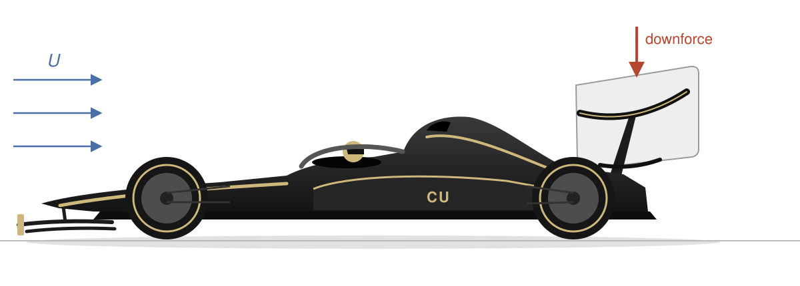
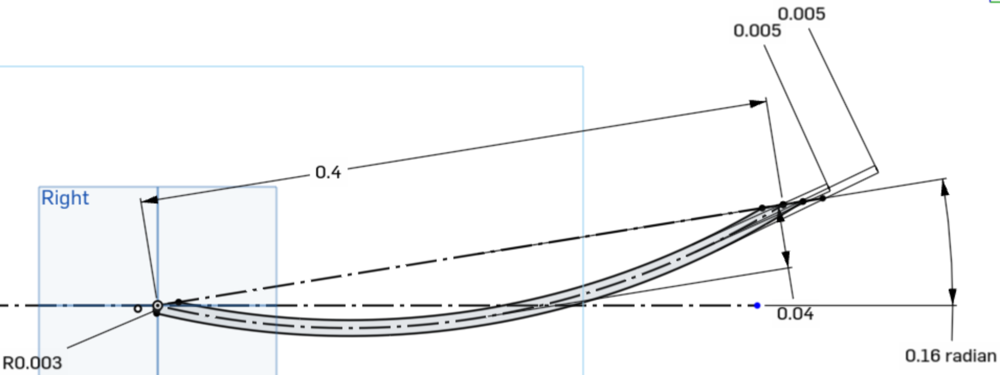
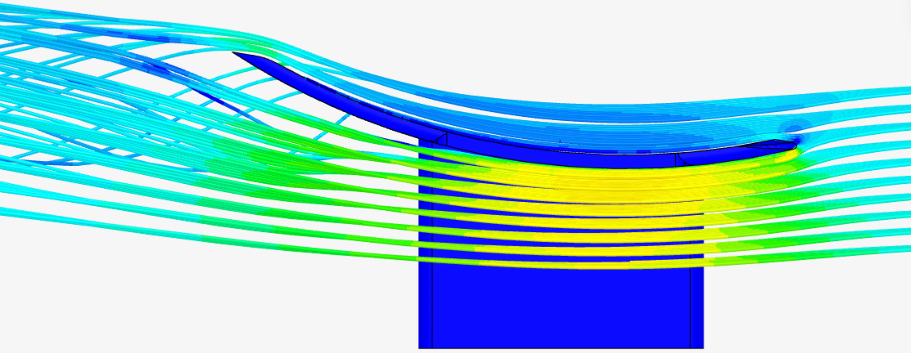

A wealthy CU Boulder alumnus has decided to start a Formula 1 racing team made up entirely of graduates from CU Boulder's College of Engineering. F1 racing is a huge money sport, with unbelievable sums going towards finding ways to shave fractions of seconds from lap times. Your team of engineers has been asked to design an airfoil to provide additional downforce to the vehicle which will increase the tire grip, allowing it to make turns at greater speeds. The team will setup, perform, and analyze a series of computational fluid dynamics simulations, varying three parameters: the angle of attack, the camber, and the vehicle speed.

{#fig-f1}

::: {.column-margin}
There is a SimScale Tutorial for "aerodynamics of a spoiler" that may be a helpful reference as well.
:::

## Preparing the part in OnShape

Step 1 in a computational analysis is to create the geometry -- I have something mostly complete, but you will tweak my design to help the team consider the optimum "angle of attack" and "camber". Download the `*.x_t` file from Canvas, and upload it to your OnShape account. This is supposed to be [half]{.underline} of an airfoil, where we will set a symmetry condition along one edge. Examine Sketch 1, which is part of the "Right" plane. It should look something like @fig-blueprint.

In this view, we are imagining flow is coming from the left, and we keep in mind that the goal is to generate a force [downwards]{.underline}. This airfoil might be called a "circular-arc" airfoil -- one that is curved but with essentially no thickness. In this example, the 0.16 radian angle is the "angle of attack", $\alpha$, defined with respect to the incoming air speed and therefore the horizontal plane. The 0.04 (meters) is the "camber", $h$, which is essentially the arc height above/below the line connecting the leading and trailing edges. The 0.4 (meters) is the "chord length", $\ell$. This parameter will be kept constant in this analysis. We will also keep the airfoil width, $w$, constant -- it is the length of the extrusion of this sketch, and so is not depicted here. The other parameters, with size 0.005 and 0.003 (meters), are just fillets to soften the corners -- these too will be kept constant.

::: {.column-margin}
The fillets may be slightly adjusted if your parameter choices cause a conflict. Let me know if it is uncooperative.
:::

{#fig-blueprint}

According to 2D airfoil theory, the lift of this circular-arc airfoil per width at a particular speed, $U$, for air with density, $\rho$, is given by

$$
\frac{F_L}{w} = \pi \rho U^2 \ell \sin\left(\alpha + \frac{2h}{\ell}\right).
$$

This expression indicates that the lift will increase with increasing angle of attack ($\alpha$), camber ($h$), and incoming fluid speed ($U$).[^constants] But of course there are limits! Most intuitively: flow will not smoothly slip over an airfoil with an extreme angle of attack and will instead create a large wake region, thus destroying the pressure differential that is responsible for generating lift while also generating huge form drag.

::: {.column-margin}
Remember we are treating the airfoil length $\ell$ and width $w$ as constant, and we will also assume constant density. Increasing these factors would also technically increase lift.
:::

You will edit the `*.x_t` part with your parameter choices, which you will obtain by signing up in a Google Sheet. I am fairly certain many of these parameter choices will create flow separation, but that does not mean they aren't interesting! When finished setting the angle of attack and camber, click the checkmark to exit the sketch and the part should successfully regenerate. If so, right click the part name in the bottom left and choose "Export". Then export as a "PARASOLID". You will immediately upload it to SimScale.

OnShape is also integrated into SimScale, and you may be able to import directly from within SimScale. They have had issues with this on certain browsers, though.

## Uploading and preparing the part in SimScale

Create a new project in SimScale and upload the parasolid (`*.x_t`) file from your computer (or import via the OnShape integration if you can). Double check that the part has the correct dimensions, I think it should be OK.

{#fig-external-flow}

We do need to edit in CAD mode to create the fluid geometry. You have two tasks: to create an (external) flow volume, and to delete the [body]{.underline} (not surface) you imported from the flow volume. My box dimensions, and the resulting geometry, are seen in @fig-external-flow. After you have the flow volume created, you will need to delete the airfoil [body]{.underline} from this geometry. (Not faces!) I was able to simply choose Part 1 to be deleted. When you have a good-looking geometry, export, and make sure you work with this new geometry in the steps going forward.

I strongly encourage you to set up the "topological entity sets" now -- doing so will allow you to set boundary conditions very quickly. You should create six sets, corresponding to the six types of boundary conditions you will set. I named them as follows:

1. **"symmetry"**: This is the mirroring wall, for which we will assign a symmetry condition.
2. **"inlet"**: This is the flow inlet, just in front of the airfoil. You will program your chosen speed into this boundary condition. Check to make sure, but for mine it is the `U_y` speed that should be nonzero.
3. **"outlet"**: This is the downstream "drain" for which you will set a zero pressure condition.
4. **"walls"**: This is the ceiling and other wall. You will choose a "slip" condition for these.
5. **"floor"**: The floor. You will choose a "moving wall" boundary condition and set the same speed as your inlet speed.
6. **"foil"**: The airfoil. Here is finally a "no-slip" boundary condition.

Note that, by creating these topological entity sets, you can hover over their names and click the associated eye to toggle their visibility.

## Setting up the simulation

Follow along with my video and/or the SimScale tutorial. You will simulate with incompressible air, steady-state, and the k-omega SST turbulence model. The boundary conditions are as described above. In "Result Control" make sure to collect Forces and Moments. Choose the airfoil, including the support, as the target -- you should be able to just choose the foil entity. We aren't going to be interested in the moments, so the center of rotation is not super important. I made it the front of the support, but I think it could be literally anything. You do not need to collect vorticity data (as I did in the video), unless you want to look at it for fun. For the mesh, change to "Hex Dominant" with moderate fineness. You do not need to refine the mesh behind the airfoil (as is described in SimScale's tutorial), but if you would like to you can. It might highlight some interesting details. When you think you've got it all set up, run the simulation.

For me, the meshing took 18 minutes (0.60 core hours), and the simulation took 30 minutes (4.13 core hours). If you choose a higher speed than I did (50 m/s), it will probably take a bit longer, not much. If you decided to try mesh-refining, it will take longer but not tremendously longer. You do not need to sit there and watch it, you can close it down and will get an email when it's done.

## Post-processing

You will submit the force measurements to a Google Form (link on Canvas). In which direction, $x$, $y$, or $z$ will the drag force point? Determine the viscous [and]{.underline} pressure forces on that direction. In which direction, $x$, $y$, or $z$ will the lift force point? Determine the viscous [and]{.underline} pressure forces on that direction too. Additionally, go into post-processing and set up a "particle trace". Choose as the seeding location somewhere such that particle paths go above and below the airfoil. My settings were: 10 seeds vertical, 10 seeds horizontal, 1.3e-2 spacing cylinders, size 1.3e-3. Take a side view of the airfoil, hiding the walls etc., and look for evidence of flow separation. Report an approximate percentage over which the flow is "attached" to the underside of the airfoil -- in @fig-particle-trace, I estimate this to be about 60%. This number will be entered into the Google Form as well.

Finally, you will share your SimScale project with one member of the instructional staff. Details about the person you will share it with will be on Canvas.

{#fig-particle-trace}
